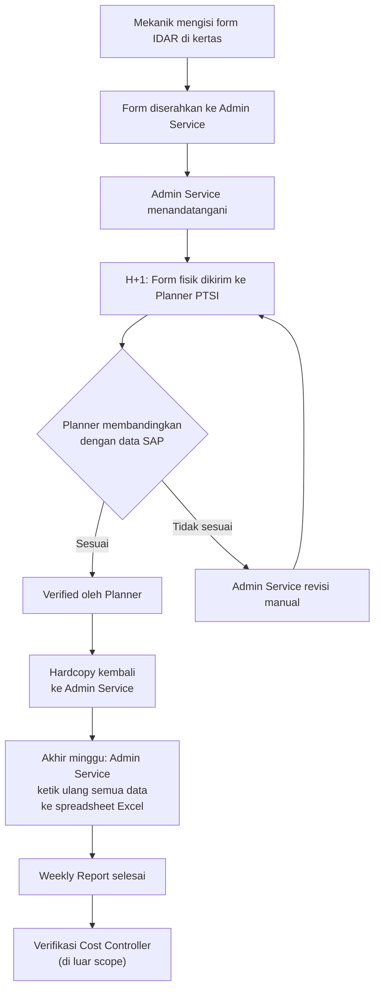
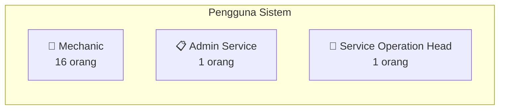
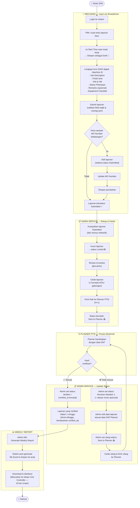
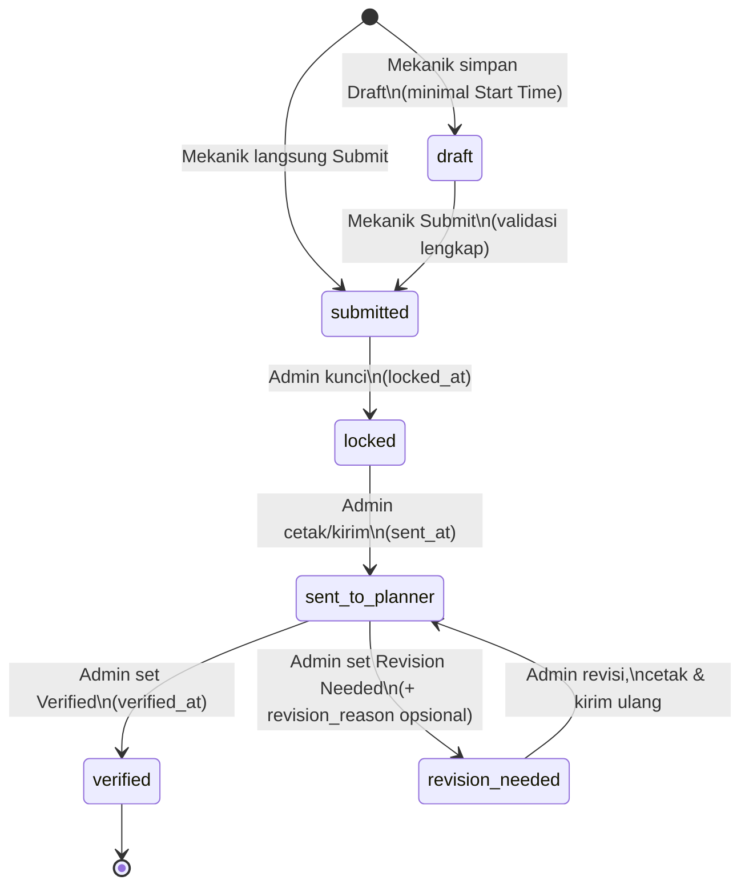
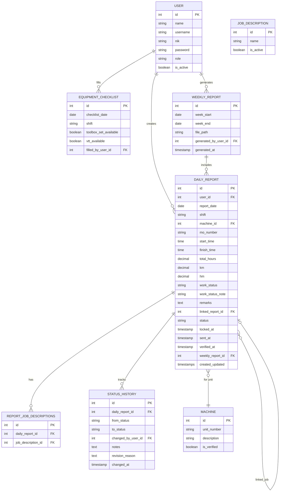

# PRD — Aplikasi Daily Routine
## PT IndoTruck Utama

| Metadata | Detail |
|---|---|
| **Versi Dokumen** | 1.1 |
| **Tanggal** | 10 Oktober 2026 |
| **Penulis** | Business Analyst / Product Manager |
| **Status** | Draft — Revisi 1 |
| **Pemohon** | Service Operation Head, PT IndoTruck Utama |
| **Model Pengembangan** | Tim kecil (1 atau lebih developer) — pendekatan AI-Assisted |

---

## Daftar Isi

1. [Executive Summary](#1-executive-summary)
2. [Problem Statement & Background](#2-problem-statement--background)
3. [Goals & Objectives](#3-goals--objectives)
4. [Scope & Out of Scope](#4-scope--out-of-scope)
5. [User Roles & Permissions](#5-user-roles--permissions)
6. [User Flow / Business Process Flow](#6-user-flow--business-process-flow)
7. [Functional Requirements](#7-functional-requirements)
8. [Data Model Overview](#8-data-model-overview)
9. [Non-Functional Requirements](#9-non-functional-requirements)
10. [Assumptions & Open Questions](#10-assumptions--open-questions)
11. [Tech Stack Summary](#11-tech-stack-summary)
12. [Appendix — Daftar Istilah](#12-appendix--daftar-istilah)

---

## 1. Executive Summary

PT IndoTruck Utama mengoperasikan layanan perawatan dan perbaikan unit kendaraan berat dengan sistem 3 shift per hari (Morning, Evening, Overnight), masing-masing diisi oleh 2 mekanik. Saat ini, seluruh proses pelaporan kerja harian mekanik masih bersifat **manual berbasis kertas** — mulai dari pengisian form "Individual Daily Activity Report" (IDAR), pengiriman fisik ke Planner eksternal (PTSI) untuk verifikasi, hingga penyusunan Weekly Report yang diketik ulang satu per satu ke spreadsheet oleh satu-satunya Admin Service.

**Aplikasi "Daily Routine"** dirancang untuk mendigitalisasi seluruh alur ini: mekanik menginput laporan kerja real-time via smartphone, Admin Service merekap dan mencetak untuk dikirim ke Planner, tracking status verifikasi dilakukan di dalam sistem, dan **Weekly Report di-generate otomatis** dari data yang sudah terverifikasi — menghilangkan proses ketik ulang manual yang memakan waktu dan rawan error.

Proyek ini dikerjakan oleh **tim pengembang kecil** (1 atau lebih developer) menggunakan pendekatan AI-assisted dengan tech stack **Laravel + Filament + Livewire**.

---

## 2. Problem Statement & Background

### 2.1 Kondisi Saat Ini (As-Is)

> [!NOTE]
> Weekly Report kemungkinan besar menjadi dokumen yang diteruskan ke tahap Cost Controller. Karena itu, **akurasi Weekly Report sangat penting** — kesalahan di Weekly Report berpotensi terbawa ke tahap berikutnya.

### 2.2 Pain Points

| # | Pain Point | Dampak |
|---|---|---|
| 1 | **Weekly Report diketik ulang manual**, dikerjakan oleh 1 orang Admin Service | Memakan waktu sangat lama, rawan salah ketik, bottleneck operasional |
| 2 | Form kertas bisa hilang, rusak, atau tidak terbaca | Data tidak reliable, proses verifikasi terhambat |
| 3 | Siklus revisi Planner berulang tanpa tracking | Tidak ada visibilitas status — laporan mana yang sudah Verified, mana yang masih Revision |
| 4 | Format penulisan tidak konsisten antar mekanik | Admin Service harus menginterpretasi ulang tulisan tangan |
| 5 | Tidak ada dashboard untuk monitoring produktivitas mekanik | Service Operation Head tidak punya visibilitas real-time |

### 2.3 Masalah Utama yang Harus Diselesaikan

> [!IMPORTANT]
> **Pain point #1 adalah prioritas tertinggi**: Menghilangkan proses ketik ulang manual Weekly Report. Sistem HARUS mampu auto-generate file Excel dengan format yang sesuai standar perusahaan dari data laporan harian yang sudah berstatus Verified.

---

## 3. Goals & Objectives

### 3.1 Goals

| # | Goal | Deskripsi |
|---|---|---|
| G1 | Digitalisasi laporan harian mekanik | Mekanik menginput laporan via smartphone secara real-time, menggantikan form kertas |
| G2 | Otomasi pembuatan Weekly Report | Sistem auto-generate file Excel sesuai format standar perusahaan dari data Verified |
| G3 | Tracking status verifikasi Planner | Admin Service dapat melacak status setiap laporan (Draft → Submitted → Locked → Sent to Planner → Verified / Revision Needed) di dalam sistem |
| G4 | Dashboard monitoring jam kerja | Service Operation Head dan Admin Service dapat melihat total jam kerja per mekanik secara visual |

### 3.2 Metrik Keberhasilan

> [!NOTE]
> Seluruh metrik di bawah ini adalah **usulan, belum divalidasi stakeholder**.

| # | Metrik | Target | Cara Ukur |
|---|---|---|---|
| M1 | Waktu pembuatan Weekly Report | Berkurang dari **berjam-jam → < 5 menit** (termasuk review sebelum kirim) | Perbandingan waktu sebelum & sesudah implementasi |
| M2 | Tingkat adopsi mekanik | **100% mekanik** (16 orang) aktif menginput laporan via sistem dalam 2 minggu pertama | Jumlah user aktif vs total mekanik |
| M3 | Pengurangan siklus revisi | Revisi karena **kesalahan format/ketik** berkurang signifikan | Jumlah Revision Needed yang disebabkan error format. **Catatan:** pengukuran ini membutuhkan data alasan revisi — karena itu ditambahkan field opsional `revision_reason` pada Status History saat status diubah ke `revision_needed` (lihat FR-VRF-09) |
| M4 | Zero paper dependency untuk internal recording | Semua data laporan tersimpan digital, kertas hanya untuk pengiriman ke Planner | Observasi proses operasional |

---

## 4. Scope & Out of Scope

### 4.1 In Scope (V1)

| # | Fitur / Area | Keterangan |
|---|---|---|
| 1 | Input laporan harian mekanik via web (mobile-friendly) | Form digital pengganti IDAR kertas, termasuk simpan sebagai Draft (input real-time) |
| 2 | Manajemen master data | Job Description list, Machine/Unit (termasuk verifikasi unit baru dari mekanik), data mekanik, shift |
| 3 | Rekap & cetak laporan oleh Admin Service | Kumpulkan laporan per hari, kunci, cetak untuk dikirim ke Planner |
| 4 | Tracking status verifikasi Planner | Admin Service update status manual (Verified / Revision Needed) |
| 5 | Siklus revisi laporan | Admin Service edit data → kirim ulang → sampai Verified |
| 6 | Auto-generate Weekly Report (Excel) | Format sesuai template standar perusahaan, beserta arsip Weekly Report yang pernah di-generate |
| 7 | Dashboard jam kerja mekanik | Bar chart harian/mingguan, untuk Admin Service & Service Operation Head |
| 8 | Role-based access control | Mechanic, Admin Service, Service Operation Head |

### 4.2 Out of Scope (TIDAK termasuk V1)

> [!CAUTION]
> Item-item berikut secara eksplisit **TIDAK** termasuk dalam scope proyek ini.

| # | Item | Alasan |
|---|---|---|
| 1 | **Tahap Cost Controller** | Di luar alur yang diminta stakeholder — proses setelah Weekly Report dibuat ditangani terpisah |
| 2 | Akses sistem untuk Planner (PTSI) | Planner adalah pihak eksternal yang tidak akan menggunakan sistem ini |
| 3 | Notifikasi (WhatsApp / Email / In-App) | Tidak diperlukan untuk V1 |
| 4 | Tanda tangan digital | Tidak diminta oleh stakeholder — tanda tangan tetap fisik di hasil cetak |
| 5 | Integrasi langsung dengan SAP | Tidak ada akses API SAP, data MO Number diinput manual |
| 6 | Fitur komentar / approval oleh Service Operation Head | Role ini hanya view-only |
| 7 | Multi-tenant / multi-cabang | Sistem hanya untuk 1 lokasi operasional |

---

## 5. User Roles & Permissions

### 5.1 Ringkasan Role

### 5.2 Detail Hak Akses

#### 5.2.1 Mechanic (16 user)

| Area | Hak Akses | Catatan |
|---|---|---|
| Laporan harian | **Create, Read, Update (terbatas)** | Bisa membuat & melihat laporan miliknya sendiri, termasuk menyimpan sebagai Draft |
| Edit laporan sendiri | **Ya, HANYA saat status `draft` atau `submitted`** | Terutama untuk menyelesaikan Draft dan menambahkan MO Number yang belum tersedia saat submit awal |
| Edit laporan setelah dikunci | **Tidak** | Mulai status `locked` dan seterusnya, mekanik tidak bisa mengedit |
| Remarks | **Isi & edit** | Selama status `draft` atau `submitted` |
| Lihat laporan mekanik lain | **Tidak** | Hanya melihat laporan milik sendiri |
| Machine / Unit baru | **Tambah (terbatas)** | Hanya jika unit tidak ditemukan di master data; unit tersimpan sebagai "belum terverifikasi" |
| Master data | **Tidak ada akses** (selain penambahan unit baru di atas) | — |
| Dashboard | **Tidak ada akses** | — |
| Weekly Report | **Tidak ada akses** | — |

#### 5.2.2 Admin Service (1 user)

| Area | Hak Akses | Catatan |
|---|---|---|
| Laporan harian | **Read semua, Edit (terbatas status), Cetak** | Bisa melihat laporan SEMUA mekanik. Edit hanya saat status `locked` atau `revision_needed` |
| Remarks | **Isi & edit** | Saat status `locked` atau `revision_needed` |
| Status verifikasi | **Update** | Mengubah status: Sent to Planner → Verified / Revision Needed |
| Revisi laporan | **Edit & Re-submit** | Mengedit konten laporan berdasarkan data SAP dari Planner, lalu set ulang status ke "Sent to Planner" |
| Master data | **Full CRUD** | Mengelola: Job Description, Machine/Unit (termasuk verifikasi unit baru dari mekanik), data mekanik, shift |
| Dashboard | **View** | Melihat total jam kerja per mekanik (harian/mingguan) |
| Weekly Report | **Generate, View & Download** | Auto-generate file Excel untuk periode mingguan, unduh ulang dari arsip |
| Manajemen user | **Create & manage akun mekanik, reset password** | Reset password dilakukan oleh Admin Service (tanpa email) |

#### 5.2.3 Service Operation Head (1 user)

> Role ini bersifat **VIEW-ONLY penuh** — dapat melihat seluruh area di bawah, tanpa hak edit sama sekali.

| Area | Hak Akses | Catatan |
|---|---|---|
| Dashboard | **View-only** | Melihat total jam kerja per mekanik (harian/mingguan), bar chart |
| Laporan harian | **View-only** | Bisa melihat semua laporan harian, TIDAK bisa edit |
| Status verifikasi | **View-only** | Bisa melihat status semua laporan, TIDAK bisa mengubah |
| Master data | **View-only** | Bisa melihat data master, TIDAK bisa edit |
| Weekly Report | **View & Download** | Bisa melihat & download Weekly Report yang sudah di-generate (termasuk arsip) |
| Komentar / Approval | **TIDAK ADA** | Role ini murni monitoring |

---

## 6. User Flow / Business Process Flow

### 6.1 Alur End-to-End (To-Be)

### 6.2 Alur Input Laporan Mekanik (Detail)

1. Mekanik **login** ke sistem via browser HP (Android) menggunakan **username atau NIK** dan password.
2. Masuk ke halaman **"Laporan Harian"**. Di halaman ini mekanik juga melihat **daftar Draft miliknya yang belum selesai**.
3. Klik **"Tambah Laporan Baru"**.
4. Sistem otomatis mengisi: **nama mekanik** (dari akun login), **shift** (bisa dipilih: Morning / Evening / Overnight), dan **tanggal laporan (`report_date`) = tanggal MULAI SHIFT**. Default tanggal: tanggal hari ini; **khusus jika shift = Overnight dan waktu pengisian sebelum 07:00, default = tanggal kemarin**. Mekanik tetap bisa mengubah tanggal secara manual.
5. Mekanik mengisi form:
   - **Start Time** — time picker. Saat mulai bekerja, mekanik cukup mengisi Start Time lalu **"Simpan Draft"**; field lain dapat dilengkapi kemudian.
   - **Machine ID / Unit Number** — pilih dari master data. Jika unit tidak ditemukan, mekanik dapat **menambahkan unit baru** yang akan ditandai "belum terverifikasi".
   - **MO Number** — opsional saat submit awal, bisa ditambahkan kemudian.
   - **Detail Job Description** — multi-select dropdown dari daftar standar + catatan tambahan (opsional).
   - **Finish Time** — time picker.
   - **Total Hours** — auto-calculate, read-only: selisih Finish − Start dalam jam (2 desimal); jika Finish < Start (melewati tengah malam) ditambah 24 jam (lihat FR-RPT-15).
   - **KM (Kilometer)** — input numerik, wajib saat submit.
   - **HM (Hour Meter)** — input numerik, wajib saat submit.
   - **Status Pekerjaan** — single-select dropdown (Selesai / Pending - Waiting Part / Pending - Over Handle Job / Pending - Waiting Bays / Others).
   - Jika **"Others"** dipilih → field catatan tambahan menjadi **WAJIB**.
   - **Linking Job** (opsional) — jika melanjutkan pekerjaan dari shift sebelumnya, bisa menautkan ke entry sebelumnya pada unit yang sama.
   - **Remarks** (opsional) — teks bebas.
6. **Equipment Checklist** — diisi **1× per shift** (bukan per mekanik): Toolbox Set (Portable) ✓/✗, Volvo Tech Tool (VTT) ✓/✗.
7. Klik **"Submit"** → sistem memvalidasi seluruh field wajib dan memastikan rentang jam **tidak bertabrakan (overlap)** dengan entry lain milik mekanik yang sama → status laporan = **Submitted**.
8. Mekanik BISA menambah entry baru untuk pekerjaan lain di shift yang sama (1 entry = 1 job).

### 6.3 Alur Rekap & Cetak oleh Admin Service

1. Admin Service membuka halaman **"Rekap Harian"**.
2. Filter berdasarkan **tanggal** dan/atau **shift**.
3. Melihat daftar semua laporan yang berstatus **Submitted**.
4. **Kunci laporan** → status berubah menjadi **Locked** (`locked_at` tercatat). Setelah dikunci, mekanik TIDAK bisa lagi mengedit.
5. Review isi laporan — **TANPA mengubah konten** (kecuali ada kesalahan yang perlu dikoreksi sebelum cetak; Admin Service dapat mengedit laporan berstatus Locked, termasuk mengisi Remarks).
6. Pilih laporan yang akan dicetak:
   - **Default**: 1 halaman cetak = 1 job (1 form).
   - **Opsi toggle**: Gabungkan beberapa job dalam 1 lembar cetak (hemat kertas).
7. Klik **"Cetak"** → generate PDF / print preview → cetak fisik. Layout mengikuti form IDAR kertas beserta blok tanda tangan fisik (lihat FR-RKP-04).
8. Status berubah menjadi **"Sent to Planner"** (`sent_at` tercatat).

### 6.4 Alur Manajemen Status Verifikasi

1. Planner PTSI melakukan verifikasi di luar sistem (bandingkan laporan cetak vs data SAP mereka).
2. Planner menyampaikan hasil ke Admin Service via telepon / WhatsApp / tatap muka.
3. Admin Service membuka halaman **"Verifikasi Planner"** di sistem.
4. Untuk setiap laporan yang berstatus **"Sent to Planner"**, Admin Service memilih:
   - ✅ **Verified** — Laporan sesuai, proses selesai (untuk scope ini). `verified_at` tercatat.
   - ⚠️ **Revision Needed** — Laporan perlu direvisi. Admin Service dapat mengisi **alasan revisi** (opsional).
5. Jika **Revision Needed**:
   - Laporan menjadi **editable kembali** untuk Admin Service (BUKAN untuk mekanik).
   - Admin Service merevisi data sesuai informasi dari Planner (berdasarkan data SAP).
   - Setelah revisi, Admin Service set status kembali ke **"Sent to Planner"**.
   - Cetak ulang → kirim ulang ke Planner → tunggu verifikasi ulang.
   - Siklus berulang sampai **Verified**.

#### 6.4.1 Diagram Status Laporan

Status laporan dikelola dengan **satu enum `status`**: `draft`, `submitted`, `locked`, `sent_to_planner`, `verified`, `revision_needed`.

| Status | Mekanik boleh edit? | Admin Service boleh edit? |
|---|---|---|
| `draft` | ✅ Ya | ❌ Tidak |
| `submitted` | ✅ Ya | ❌ Tidak |
| `locked` | ❌ Tidak | ✅ Ya |
| `sent_to_planner` | ❌ Tidak | ❌ Tidak |
| `revision_needed` | ❌ Tidak | ✅ Ya |
| `verified` | ❌ Tidak | ❌ Tidak |

### 6.5 Alur Generate Weekly Report

1. Admin Service membuka halaman **"Weekly Report"**.
2. Pilih **periode minggu** (Senin–Minggu).
3. Sistem menampilkan **preview**: laporan-laporan yang **berubah status menjadi Verified pada minggu tersebut** (berdasarkan `verified_at`) dan belum pernah dimasukkan ke Weekly Report lain (`weekly_report_id` masih kosong).
4. Laporan yang BELUM Verified di akhir minggu **TIDAK dimasukkan** — ditunda ke minggu saat laporan tersebut Verified.
5. Di dalam sheet, baris diurutkan berdasarkan **`report_date` (tanggal kerja asli)** lalu **shift**; kolom DATE tetap menampilkan tanggal kerja asli.
6. Klik **"Generate Excel"** → sistem membuat file Excel dengan format standar perusahaan, menyimpannya ke **arsip**, dan menandai setiap laporan yang dimasukkan (`weekly_report_id` diisi).
7. Download file Excel. Weekly Report yang pernah di-generate dapat **diunduh ulang** kapan saja dari arsip.

---

## 7. Functional Requirements

### 7.1 Modul: Input Laporan Harian Mekanik

| ID | Requirement | Prioritas | Catatan |
|---|---|---|---|
| FR-RPT-01 | Mekanik dapat membuat entry laporan baru per pekerjaan (1 entry = 1 job) | **MUST** | Setiap entry terikat pada 1 mekanik, 1 tanggal (`report_date`), 1 shift |
| FR-RPT-02 | Form harus menyediakan field: Machine ID, MO Number, Detail Job Description (multi-select + catatan), Start Time, Finish Time, Total Hours (auto), KM, HM, Status Pekerjaan, Linking Job, Remarks | **MUST** | Detail validasi per field lihat Bagian 7.1.1 |
| FR-RPT-03 | MO Number BOLEH dikosongkan saat submit awal | **MUST** | Mekanik bisa edit untuk menambahkan MO Number kemudian, selama status masih `submitted` |
| FR-RPT-04 | Mekanik HANYA bisa melihat & mengedit laporan milik sendiri | **MUST** | Tidak bisa melihat laporan mekanik lain |
| FR-RPT-05 | Mekanik BISA mengedit laporan sendiri HANYA selama status `draft` atau `submitted` | **MUST** | Setelah status berubah ke `locked` (dan seterusnya), mekanik tidak bisa edit lagi |
| FR-RPT-06 | Jika 2 mekanik mengerjakan unit yang sama dalam 1 shift, TETAP dicatat sebagai 2 entry terpisah | **MUST** | Masing-masing mekanik submit laporan atas namanya sendiri |
| FR-RPT-07 | Linking Job (opsional): mekanik BISA menautkan entry baru ke entry job sebelumnya yang berstatus Pending pada unit yang sama | **SHOULD** | Agar riwayat pekerjaan yang dilanjutkan tersambung sebagai 1 thread |
| FR-RPT-08 | Form HARUS mobile-friendly dan bisa diakses via browser HP Android | **MUST** | Mekanik menginput real-time saat bekerja |
| FR-RPT-09 | Mekanik dapat menyimpan entry sebagai **Draft** dengan hanya **Start Time** terisi. Field wajib lainnya (Finish Time, Status Pekerjaan, dsb.) baru divalidasi saat tombol **Submit** ditekan | **MUST** | Mendukung input real-time: entry dibuat saat mulai kerja, dilengkapi saat selesai |
| FR-RPT-10 | Mekanik dapat melihat **daftar Draft miliknya yang belum selesai** dan melanjutkan pengisiannya | **MUST** | — |
| FR-RPT-11 | Sistem menolak penyimpanan entry jika rentang waktu (Start–Finish) **bertabrakan (overlap)** dengan entry lain milik mekanik yang sama, termasuk memperhitungkan job yang melewati tengah malam | **MUST** | Agar total jam di dashboard tidak terhitung ganda. Berlaku untuk penyimpanan oleh mekanik maupun Admin Service. Penentuan tanggal kalender untuk jam setelah tengah malam pada shift Overnight lihat OQ-13 |
| FR-RPT-12 | `report_date` = **tanggal MULAI SHIFT**, bukan tanggal saat laporan diisi. Default di form: jika shift = Overnight dan waktu pengisian sebelum 07:00, default = tanggal kemarin; selain itu tanggal hari ini. Mekanik dapat mengubah secara manual | **MUST** | Contoh: job overnight yang mulai 04:00 tanggal 7 tetap tercatat `report_date` tanggal 6 jika shift-nya dimulai tanggal 6 malam |
| FR-RPT-13 | Jika Machine ID / Unit Number tidak ditemukan di master data, mekanik dapat **menambahkan unit baru**. Unit tersebut tersimpan dengan `is_verified = false` ("belum terverifikasi") | **MUST** | Agar pekerjaan tidak terblokir. Admin Service memverifikasi/merapikan kemudian (FR-MDM-07) |
| FR-RPT-14 | Field **Remarks** (teks bebas, opsional) dapat diisi oleh mekanik (status `draft`/`submitted`) dan Admin Service (status `locked`/`revision_needed`) | **MUST** | Dipetakan ke kolom "Remarks" di Weekly Report Excel |
| FR-RPT-15 | **Total Hours** = selisih Finish − Start dalam satuan jam, desimal 2 digit. Jika Finish < Start (melewati tengah malam), ditambah 24 jam. Finish 00:00 dengan Start > 00:00 diperlakukan sebagai 24:00 | **MUST** | Keputusan final. Contoh: 23:00 s.d. 03:30 = 4,50 jam; 20:00 s.d. 00:00 = 4,00 jam |

#### 7.1.1 Validasi Field Laporan

| Field | Tipe Input | Validasi | Wajib saat Draft? | Wajib saat Submit? |
|---|---|---|---|---|
| **Machine ID / Unit Number** | Text / Autocomplete dari master data | Dipilih dari master data. Jika belum ada, mekanik dapat menambahkan unit baru (tersimpan `is_verified = false`) | ❌ Tidak | ✅ Wajib |
| **MO Number** | Numerik | Format numerik, panjang digit TBD (lihat OQ-02) | ❌ Tidak | ❌ Opsional, bisa ditambahkan kemudian |
| **Detail Job Description** | Multi-select dropdown + Text area (catatan) | Pilihan dari master data, diurutkan alfabetis. Catatan tambahan opsional | ❌ Tidak | ✅ Wajib (minimal 1 pilihan dari dropdown) |
| **Start Time** | Time picker | WAJIB via time picker, BUKAN input teks manual. Tidak boleh overlap dengan entry lain milik mekanik yang sama | ✅ Wajib | ✅ Wajib |
| **Finish Time** | Time picker | WAJIB via time picker, BUKAN input teks manual. Boleh lebih kecil dari Start Time (dianggap melewati tengah malam, +24 jam). Finish 00:00 dengan Start > 00:00 = 24:00. Rentang Start–Finish tidak boleh overlap dengan entry lain milik mekanik yang sama | ❌ Tidak | ✅ Wajib |
| **Total Hours** | Auto-calculated, read-only | Finish − Start dalam jam (2 desimal); +24 jam jika Finish < Start (lihat FR-RPT-15) | Auto (jika Finish terisi) | ✅ Auto (tidak diinput) |
| **KM (Kilometer)** | Numerik | Bilangan positif | ❌ Tidak | ✅ Wajib |
| **HM (Hour Meter)** | Numerik | Bilangan positif (bisa desimal) | ❌ Tidak | ✅ Wajib |
| **Status Pekerjaan** | Single-select dropdown | Pilihan: Selesai, Pending - Waiting Part, Pending - Over Handle Job, Pending - Waiting Bays, Others | ❌ Tidak | ✅ Wajib |
| **Catatan Tambahan (untuk "Others")** | Text area | WAJIB diisi jika Status Pekerjaan = "Others" | ❌ Tidak | Kondisional |
| **Linking Job** | Select / search dari entry sebelumnya (unit yang sama, status Pending) | Opsional, hanya tampil jika ada entry Pending di unit yang sama | ❌ Tidak | ❌ Opsional |
| **Remarks** | Text area | Teks bebas | ❌ Tidak | ❌ Opsional |

### 7.2 Modul: Equipment Checklist

| ID | Requirement | Prioritas | Catatan |
|---|---|---|---|
| FR-EQP-01 | Equipment Checklist diisi **1 kali per shift**, BUKAN per mekanik individual | **MUST** | Karena alat dipakai bersama dalam 1 shift. Tanggal checklist mengikuti tanggal mulai shift (sama dengan aturan `report_date`) |
| FR-EQP-02 | Item checklist: "Toolbox Set (Portable)" dan "Volvo Tech Tool (VTT)" | **MUST** | Format: tersedia (✓) / tidak tersedia (✗) |
| FR-EQP-03 | Checklist bisa diisi oleh mekanik MANAPUN yang pertama kali submit laporan di shift tersebut | **SHOULD** | Mekanik kedua di shift yang sama melihat checklist sudah terisi |
| FR-EQP-04 | Checklist bisa diedit oleh salah satu mekanik di shift tersebut sebelum laporan dikunci | **SHOULD** | — |

### 7.3 Modul: Rekap & Cetak oleh Admin Service

| ID | Requirement | Prioritas | Catatan |
|---|---|---|---|
| FR-RKP-01 | Admin Service dapat melihat daftar semua laporan, difilter per tanggal dan/atau shift | **MUST** | — |
| FR-RKP-02 | Admin Service dapat **mengunci** laporan berstatus `submitted` yang sudah siap dikirim ke Planner → status menjadi `locked`, `locked_at` diisi | **MUST** | Setelah dikunci, mekanik tidak bisa mengedit lagi; Admin Service masih bisa mengedit untuk koreksi sebelum cetak |
| FR-RKP-03 | Admin Service dapat mencetak laporan dengan 2 mode: (a) 1 halaman = 1 job, (b) beberapa job digabung dalam 1 halaman (toggle opsional) | **MUST** | Opsi gabung untuk menghemat kertas |
| FR-RKP-04 | Hasil cetak mengikuti layout **form IDAR kertas** perusahaan, ditambah field baru: **KM, HM, Status Pekerjaan, Equipment Checklist**, serta **blok tanda tangan fisik**: Mechanic, Supervisor, Section Head, dan kolom **"Checked By PTSI Workshop Direct Superior"** sesuai form asli | **SHOULD** | Detail layout final lihat OQ-07 |
| FR-RKP-05 | Setelah dicetak, status laporan otomatis berubah menjadi **`sent_to_planner`** dan `sent_at` (waktu cetak/kirim) diisi | **MUST** | — |
| FR-RKP-06 | Admin Service dapat mencetak ulang laporan yang berstatus "Revision Needed" setelah direvisi | **MUST** | Bagian dari siklus revisi |
| FR-RKP-07 | Service Operation Head dapat **melihat** (view-only) semua laporan harian | **MUST** | Tanpa hak edit, kunci, atau cetak-ubah-status |

### 7.4 Modul: Manajemen Status Verifikasi Planner

| ID | Requirement | Prioritas | Catatan |
|---|---|---|---|
| FR-VRF-01 | Admin Service memiliki halaman/fitur khusus untuk melihat semua laporan berstatus `sent_to_planner` | **MUST** | — |
| FR-VRF-02 | Admin Service dapat mengubah status laporan menjadi **`verified`**; `verified_at` diisi saat perubahan ini | **MUST** | `verified_at` menentukan minggu masuknya laporan ke Weekly Report (FR-WKL-02) |
| FR-VRF-03 | Admin Service dapat mengubah status laporan menjadi **`revision_needed`** | **MUST** | — |
| FR-VRF-04 | Saat status diubah ke `revision_needed`, laporan menjadi **editable kembali** untuk Admin Service | **MUST** | Mekanik TIDAK bisa edit laporan berstatus `revision_needed` |
| FR-VRF-05 | Admin Service dapat merevisi konten laporan (semua field kecuali nama mekanik & tanggal asli), termasuk Remarks | **MUST** | Revisi berdasarkan data SAP yang diberikan Planner. Validasi overlap (FR-RPT-11) tetap berlaku |
| FR-VRF-06 | Setelah direvisi, Admin Service set ulang status ke **`sent_to_planner`** untuk dikirim ulang | **MUST** | Status berubah → laporan bisa dicetak ulang; `sent_at` diperbarui |
| FR-VRF-07 | Siklus `revision_needed` → Edit → `sent_to_planner` bisa **berulang tanpa batas** sampai akhirnya `verified` | **MUST** | — |
| FR-VRF-08 | Sistem mencatat **riwayat perubahan status** (audit trail) — siapa yang mengubah, kapan, dari status apa ke status apa | **SHOULD** | Untuk traceability |
| FR-VRF-09 | Saat mengubah status ke `revision_needed`, Admin Service dapat mengisi **alasan revisi** (`revision_reason`, opsional) yang tersimpan di Status History | **SHOULD** | Dibutuhkan untuk pengukuran Metrik M3 |
| FR-VRF-10 | Service Operation Head dapat **melihat** status verifikasi semua laporan beserta riwayatnya (view-only) | **MUST** | Tidak bisa mengubah status |

### 7.5 Modul: Master Data Management

| ID | Requirement | Prioritas | Catatan |
|---|---|---|---|
| FR-MDM-01 | Admin Service dapat mengelola (CRUD) daftar **Detail Job Description** | **MUST** | Dropdown multi-select di form mekanik diisi dari master data ini |
| FR-MDM-02 | Admin Service dapat mengelola (CRUD) daftar **Machine / Unit** | **MUST** | Master data unit kendaraan yang dikerjakan mekanik |
| FR-MDM-03 | Admin Service dapat mengelola (CRUD) data **Mekanik** (nama, username, NIK, akun, shift default) | **MUST** | Termasuk create/disable akun mekanik |
| FR-MDM-04 | Admin Service dapat mengelola (CRUD) data **Shift** (nama shift, jam default) | **SHOULD** | Morning, Evening, Overnight — bisa dikonfigurasi |
| FR-MDM-05 | Service Operation Head dapat **melihat** (view-only) semua master data | **MUST** | Tidak bisa edit |
| FR-MDM-06 | Daftar Job Description di form mekanik diurutkan **alfabetis** | **MUST** | — |
| FR-MDM-07 | Admin Service dapat melihat daftar unit **belum terverifikasi** (`is_verified = false`) yang ditambahkan mekanik, lalu **memverifikasi** atau **merapikannya** (mis. memperbaiki penulisan Unit Number) di master data | **MUST** | Unit belum terverifikasi tetap bisa dipakai di laporan agar pekerjaan tidak terblokir |

### 7.6 Modul: Dashboard & Reporting

| ID | Requirement | Prioritas | Catatan |
|---|---|---|---|
| FR-DSH-01 | Dashboard menampilkan **total jam kerja per mekanik** (harian) | **MUST** | — |
| FR-DSH-02 | Dashboard menampilkan **total jam kerja per mekanik** (mingguan) | **MUST** | Periode Senin–Minggu |
| FR-DSH-03 | Visualisasi menggunakan **grafik batang (bar chart)** | **MUST** | — |
| FR-DSH-04 | Dashboard dapat diakses oleh **Admin Service** dan **Service Operation Head** | **MUST** | — |
| FR-DSH-05 | Dashboard TIDAK dapat diakses oleh Mechanic | **MUST** | — |
| FR-DSH-06 | Data yang ditampilkan di dashboard mencakup **semua laporan** (termasuk yang belum Verified) — untuk monitoring real-time | **SHOULD** | Bisa ditambahkan filter status jika diperlukan. Perlakuan entry `draft` lihat OQ-18 |

### 7.7 Modul: Auto-Generate Weekly Report (Excel)

> [!IMPORTANT]
> Ini adalah **fitur inti** dan **value utama** aplikasi bagi bisnis. Kualitas output Excel HARUS sesuai dengan format standar perusahaan.

| ID | Requirement | Prioritas | Catatan |
|---|---|---|---|
| FR-WKL-01 | Admin Service dapat memilih **periode minggu** (Senin–Minggu) untuk generate Weekly Report | **MUST** | — |
| FR-WKL-02 | **HANYA laporan berstatus `verified`** yang dimasukkan ke Weekly Report, yaitu laporan yang **`verified_at`-nya jatuh pada periode minggu tersebut** dan belum pernah dimasukkan ke Weekly Report lain (`weekly_report_id` kosong) | **MUST** | Laporan yang belum Verified di akhir minggu ditunda ke minggu saat laporan tersebut Verified |
| FR-WKL-03 | `report_date` untuk shift overnight = **tanggal MULAI SHIFT**. Semua job dalam 1 shift overnight tercatat di 1 tanggal yang sama, termasuk job yang dimulai setelah tengah malam | **MUST** | Misal: shift overnight dimulai tanggal 6 malam, job mulai 04:00 tanggal 7 → `report_date` tanggal 6. Sesuai data asli |
| FR-WKL-04 | Sistem auto-generate file **Excel (.xlsx)** dengan format standar perusahaan | **MUST** | Bukan CSV atau format lain |
| FR-WKL-05 | Format kolom Excel: NO, DATE (tanggal kerja asli / `report_date`), Shift, Man Power (nama mekanik), NO (index job), Unit Number, MO Number, Description, Start, Finish, Mech. Avl (hrs) — formula Excel (FR-WKL-12), Remarks (dari field `remarks`) | **MUST** | Struktur kolom sesuai template perusahaan. Pada sampel template, kolom Remarks kosong |
| FR-WKL-06 | Data disusun **berurutan per `report_date`** (tanggal kerja asli) lalu **shift**, dalam **1 sheet** untuk 1 periode minggu | **MUST** | BUKAN sheet terpisah per hari. Kebutuhan baris kosong cadangan lihat OQ-10 |
| FR-WKL-07 | File Excel mendukung **merged cells & formula** agar sesuai format asli perusahaan | **SHOULD** | Menggunakan PhpSpreadsheet via Laravel Excel. Formula kolom Mech. Avl (hrs) bersifat MUST (FR-WKL-12) |
| FR-WKL-08 | Sistem menampilkan **preview** data sebelum generate (daftar laporan yang akan masuk) | **SHOULD** | Admin Service bisa review sebelum download |
| FR-WKL-09 | Service Operation Head dapat **melihat & download** Weekly Report yang sudah di-generate | **MUST** | Termasuk dari arsip |
| FR-WKL-10 | Laporan yang Verified **setelah** periode minggu kerjanya berakhir masuk ke Weekly Report **minggu saat laporan tersebut Verified** (berdasarkan `verified_at`), dengan kolom DATE tetap menampilkan tanggal kerja asli | **MUST** | Keputusan kerja; konfirmasi ringan ke stakeholder (OQ-11, bukan blocker) |
| FR-WKL-11 | Sistem **menyimpan setiap Weekly Report yang pernah di-generate** (arsip) dan file tersebut dapat **diunduh ulang** | **MUST** | Diakses oleh Admin Service dan Service Operation Head |
| FR-WKL-12 | Kolom **"Mech. Avl (hrs)"** ditulis sebagai **FORMULA Excel** yang identik dengan template perusahaan: `=(J-I)*24` untuk job normal dan `=((J-I)*24)+24` untuk job yang melewati tengah malam. Sel Start (I) dan Finish (J) berformat waktu | **MUST** | `×24` mengonversi pecahan hari Excel (cara Excel menyimpan waktu) menjadi jam. Hasil formula harus sama dengan Total Hours di sistem (FR-RPT-15) |
| FR-WKL-13 | Saat Weekly Report di-generate, setiap laporan yang dimasukkan ditandai dengan `weekly_report_id` sehingga **satu laporan tidak dapat masuk ke dua Weekly Report berbeda** | **MUST** | — |

### 7.8 Modul: Autentikasi & Otorisasi

| ID | Requirement | Prioritas | Catatan |
|---|---|---|---|
| FR-AUTH-01 | Sistem menggunakan **login berbasis USERNAME atau NIK & password** (bukan email) | **MUST** | Mekanisme teknis diputuskan di dokumen Architecture |
| FR-AUTH-02 | Setiap user memiliki tepat **1 role**: Mechanic, Admin Service, atau Service Operation Head | **MUST** | Menggunakan spatie/laravel-permission |
| FR-AUTH-03 | Akses halaman & fitur dibatasi berdasarkan role | **MUST** | Middleware & policy |
| FR-AUTH-04 | Admin Service dapat **membuat akun** untuk mekanik baru dan **menonaktifkan** akun mekanik yang sudah tidak aktif | **MUST** | — |
| FR-AUTH-05 | Mechanic TIDAK bisa mendaftar sendiri (no self-registration) | **MUST** | Akun dibuat oleh Admin Service |
| FR-AUTH-06 | Sistem hanya memiliki **SATU halaman login** untuk semua role, lalu mengarahkan user ke halaman yang sesuai role-nya | **MUST** | Mekanisme teknis (Breeze vs Filament) adalah Open Item untuk dokumen Architecture (Bagian 11.2) |
| FR-AUTH-07 | **Reset password dilakukan oleh Admin Service** (tanpa email) | **MUST** | Notifikasi email di luar scope dan mekanik belum tentu memiliki email |

---

## 8. Data Model Overview

> [!NOTE]
> Ini adalah model data level tinggi untuk memberikan gambaran entitas dan relasi. Detail skema database (tipe kolom, index, migration) akan dijabarkan di dokumen Architecture terpisah.

### 8.1 Diagram Relasi Entitas

### 8.2 Deskripsi Entitas

| Entitas | Deskripsi | Catatan |
|---|---|---|
| **User** | Akun pengguna sistem (mekanik, admin service, service operation head) | Login menggunakan `username` atau `nik` + password. Role dikelola via spatie/laravel-permission. Reset password oleh Admin Service |
| **Daily Report** | Entry laporan harian per pekerjaan per mekanik | 1 entry = 1 job. `report_date` = tanggal mulai shift. Field `status` (satu enum) menyimpan status alur kerja: `draft`, `submitted`, `locked`, `sent_to_planner`, `verified`, `revision_needed`. `locked_at` = waktu dikunci Admin, `sent_at` = waktu cetak/kirim ke Planner (diperbarui saat kirim ulang), `verified_at` = waktu status menjadi Verified (acuan minggu Weekly Report). `remarks` = teks bebas opsional, dipetakan ke kolom Remarks Weekly Report. `weekly_report_id` diisi saat laporan dimasukkan ke Weekly Report (mencegah masuk dua kali). `total_hours` dihitung sesuai FR-RPT-15. Entry `draft` boleh hanya memiliki `start_time` |
| **Machine** | Master data unit kendaraan/truk yang dikerjakan mekanik | Diidentifikasi oleh `unit_number`. `is_verified = false` untuk unit yang ditambahkan mekanik dan belum diverifikasi Admin Service |
| **Job Description** | Master data daftar standar jenis pekerjaan | Digunakan sebagai opsi multi-select di form mekanik. Diurutkan alfabetis. `is_active` untuk soft-delete |
| **Report Job Descriptions** | Tabel pivot relasi many-to-many antara Daily Report dan Job Description | 1 laporan bisa memiliki beberapa jenis pekerjaan |
| **Equipment Checklist** | Checklist ketersediaan alat per shift per hari | 1 record per shift per hari (bukan per mekanik). `checklist_date` mengikuti tanggal mulai shift. Diisi oleh mekanik pertama yang submit laporan di shift tersebut |
| **Status History** | Audit trail perubahan status laporan | Mencatat: siapa mengubah, kapan, dari status apa ke status apa, catatan, serta `revision_reason` (opsional) saat status diubah ke `revision_needed` |
| **Weekly Report** | Record (arsip) file Weekly Report yang di-generate | Menyimpan path file Excel yang dihasilkan, periode minggu, dan siapa yang generate. Setiap file dapat diunduh ulang |

### 8.3 Catatan Relasi Penting

1. **Daily Report → Daily Report (self-referencing, Linked Job)**: Relasi opsional. Entry baru BISA menautkan ke entry sebelumnya pada unit yang sama yang berstatus Pending, membentuk thread riwayat pekerjaan yang berkelanjutan.
2. **Daily Report ↔ Job Description (many-to-many)**: Satu laporan bisa mencakup beberapa jenis pekerjaan (multi-select), dan satu jenis pekerjaan bisa muncul di banyak laporan.
3. **Equipment Checklist**: Unik per kombinasi `(checklist_date, shift)` — hanya 1 record per shift per hari, terlepas dari jumlah mekanik yang bekerja di shift tersebut.
4. **Weekly Report → Daily Report (one-to-many)**: Relasi eksplisit melalui `daily_reports.weekly_report_id`. Kandidat laporan untuk suatu minggu dipilih berdasarkan status `verified`, `verified_at` di dalam periode minggu, dan `weekly_report_id` masih kosong. Setelah generate, `weekly_report_id` diisi sehingga laporan tidak masuk ke Weekly Report lain.
5. **Daily Report → Machine**: Laporan boleh merujuk ke Machine dengan `is_verified = false`.

---

## 9. Non-Functional Requirements

### 9.1 Performa

| ID | Requirement | Target |
|---|---|---|
| NFR-01 | Waktu respons halaman web (page load) | **< 3 detik** pada koneksi 4G standar |
| NFR-02 | Waktu generate Weekly Report (Excel) | **< 30 detik** untuk data 1 minggu (~16 mekanik × 7 hari × rata-rata 3 job/mekanik/hari ≈ 336 records) |
| NFR-03 | Sistem mendukung **~18 concurrent users** | 16 mekanik + 1 admin + 1 service operation head |
| NFR-04 | Database query untuk dashboard & reporting | Tetap responsif dengan data **hingga 1 tahun** (~17.000 records) |

### 9.2 Kompatibilitas & Aksesibilitas

| ID | Requirement | Target |
|---|---|---|
| NFR-05 | **Mobile-first** untuk role Mechanic | Form input HARUS nyaman digunakan di layar HP Android (Chrome browser) |
| NFR-06 | Desktop-friendly untuk role Admin Service & Service Operation Head | Dashboard & halaman admin optimal di layar desktop/laptop |
| NFR-07 | Browser support | Chrome (Android & Desktop) sebagai prioritas utama. Firefox & Edge sebagai secondary |
| NFR-08 | Tidak perlu installasi aplikasi native | Cukup akses via browser (Progressive Web App opsional untuk V2) |

### 9.3 Keamanan

| ID | Requirement | Target |
|---|---|---|
| NFR-09 | Autentikasi berbasis session (Laravel default) | Setiap aksi memerlukan login aktif |
| NFR-10 | Role-based access control pada setiap route & endpoint | Middleware authorization di setiap halaman |
| NFR-11 | Password hashing menggunakan bcrypt (Laravel default) | — |
| NFR-12 | CSRF protection pada semua form | Laravel default |
| NFR-13 | Input validation & sanitization | Mencegah SQL injection, XSS |
| NFR-14 | HTTPS (TLS) wajib di production | Konfigurasi di hosting (TBD). Kemungkinan besar sistem diakses via internet publik (lihat OQ-08) |

### 9.4 Reliability & Data Integrity

| ID | Requirement | Target |
|---|---|---|
| NFR-15 | Database backup reguler | Minimal daily backup (konfigurasi di hosting, TBD) |
| NFR-16 | Tidak boleh ada data laporan yang hilang atau duplikat akibat concurrent submit | Gunakan database transaction & unique constraints |
| NFR-17 | Audit trail perubahan status harus lengkap dan tidak bisa dihapus | Status History bersifat append-only |
| NFR-21 | Tidak boleh ada dua entry milik mekanik yang sama dengan rentang waktu yang overlap (termasuk job yang melewati tengah malam) | Validasi di sisi server pada setiap penyimpanan, agar total jam di dashboard dan Weekly Report tidak terhitung ganda |
| NFR-22 | Satu laporan hanya boleh tercatat di satu Weekly Report | Ditegakkan melalui `weekly_report_id` dalam transaction saat generate |

### 9.5 Maintainability

| ID | Requirement | Target |
|---|---|---|
| NFR-18 | Kode mengikuti standar Laravel (PSR-12, Eloquent conventions) | Memudahkan maintenance oleh developer lain di masa depan |
| NFR-19 | Seeding data master (Job Description, Machine, User) tersedia | Untuk kemudahan setup awal & demo |
| NFR-20 | Environment configuration via `.env` file | Standar Laravel |
| NFR-23 | Konvensi kode yang konsisten di seluruh tim | Disepakati dan dijalankan bersama oleh seluruh anggota tim. Detail di dokumen Architecture |
| NFR-24 | Alur Git yang jelas (branching dan code review) | Setiap perubahan melalui alur branching & code review yang disepakati. Detail di dokumen Architecture |
| NFR-25 | Dokumentasi setup lokal | Developer baru dapat menyiapkan environment lokal mengikuti dokumentasi. Detail di dokumen Architecture |

---

## 10. Assumptions & Open Questions

### 10.1 Asumsi yang Digunakan

| # | Asumsi | Catatan |
|---|---|---|
| A1 | Semua mekanik memiliki **HP Android** dengan browser Chrome dan akses internet (Wi-Fi atau data seluler) di area kerja | Jika tidak, perlu solusi offline — saat ini diasumsikan TIDAK perlu offline mode |
| A2 | **Sampel template Excel Weekly Report** dari stakeholder menjadi acuan format | Developer akan mereplikasi format tersebut menggunakan Laravel Excel / PhpSpreadsheet. Kebutuhan baris kosong cadangan lihat OQ-10 |
| A3 | Admin Service memiliki akses ke **printer** untuk mencetak laporan yang dikirim ke Planner | Proses cetak menggunakan fitur Print dari browser (atau generate PDF) |
| A4 | **MO Number** bersifat numerik dan unik per pekerjaan (tidak ada 2 pekerjaan berbeda dengan MO Number sama) | Validasi uniqueness bisa direlaksasi jika ternyata tidak unik |
| A5 | **Daftar mekanik tetap** (16 orang) — penambahan/pengurangan mekanik jarang terjadi dan dilakukan oleh Admin Service | Tidak perlu fitur self-registration |
| A6 | Karena mekanik mengakses sistem dari HP, sistem **kemungkinan besar perlu diakses dari internet publik dengan HTTPS** | Belum final — lihat OQ-08. Mempengaruhi konfigurasi keamanan & hosting |
| A8 | Laporan masuk ke Weekly Report pada **minggu saat statusnya berubah menjadi Verified** (berdasarkan `verified_at`). Di dalam sheet, baris diurutkan berdasarkan **`report_date` (tanggal kerja asli)** lalu shift, dan kolom DATE menampilkan tanggal kerja asli | Keputusan kerja — konfirmasi ringan ke stakeholder di OQ-11 (bukan blocker) |

> Asumsi A7 (rumus Total Hours) dihapus pada v1.1 karena sudah diputuskan — lihat FR-RPT-15 dan FR-WKL-12.

### 10.2 Open Questions (Perlu Jawaban dari Stakeholder)

> [!WARNING]
> Item-item berikut HARUS dijawab oleh stakeholder sebelum atau selama development. Developer boleh memulai development dengan asumsi sementara yang dicantumkan, namun harus divalidasi.

| # | Pertanyaan | Status | Asumsi Sementara |
|---|---|---|---|
| OQ-01 | Apa **daftar lengkap** pilihan dropdown "Detail Job Description"? | ⏳ Menyusul dari stakeholder | Master data kosong/placeholder, Admin Service akan mengisi sendiri via panel admin |
| OQ-02 | Berapa **jumlah digit / format pasti** MO Number? Apakah ada prefix/suffix? | ⏳ Belum dijawab | Asumsikan numerik, panjang bebas (max 20 digit), validasi bisa disesuaikan kemudian |
| OQ-03 | **Platform hosting** apa yang akan digunakan? (VPS, shared hosting, cloud?) | ⏳ TBD | Tidak diasumsikan platform tertentu. Kode harus portable |
| OQ-07 | Konfirmasi **layout cetak** laporan untuk Planner: layout mengikuti form IDAR kertas + field baru (KM, HM, Status Pekerjaan, Equipment Checklist) + blok tanda tangan fisik (Mechanic, Supervisor, Section Head, "Checked By PTSI Workshop Direct Superior"). Bagaimana penempatan field baru, dan apakah Planner menerima tambahan field tersebut? | ⏳ Belum dijawab | Asumsikan layout menyerupai form IDAR kertas dengan field baru ditambahkan, disesuaikan saat development (FR-RKP-04) |
| OQ-08 | Akses sistem: **internal network only** atau bisa diakses dari internet publik? | ⏳ TBD | Mekanik memakai HP, sehingga kemungkinan besar butuh **akses internet publik dengan HTTPS**. Mempengaruhi konfigurasi keamanan |
| OQ-10 | Apakah Weekly Report Excel harus **mereplikasi baris kosong cadangan** seperti template asli (tiap mekanik 5 slot job × 21 baris, walau kosong), atau boleh tampil **ringkas tanpa baris kosong**? | ⏳ Belum dijawab | — |
| OQ-11 | **Konfirmasi ringan** aturan A8/FR-WKL-10: laporan masuk Weekly Report pada **minggu saat Verified** (berdasarkan `verified_at`), dengan kolom DATE tetap tanggal kerja asli | ⏳ Konfirmasi (bukan blocker) | Development berjalan dengan aturan ini |
| OQ-12 | Apa **sumber dan penggunaan kolom Remarks** menurut stakeholder? (Pada sampel template, kolom ini kosong) | ⏳ Belum dijawab | Field teks bebas opsional, diisi mekanik/Admin Service (FR-RPT-14) |
| OQ-13 | Pada shift **Overnight**, `report_date` = tanggal mulai shift, tetapi jam setelah tengah malam (mis. 04:00) terjadi di tanggal kalender berikutnya. Bagaimana sistem menentukan tanggal kalender sebenarnya dari suatu jam? Ini diperlukan untuk validasi overlap (FR-RPT-11) dan urutan job di dalam shift | ⏳ Perlu konfirmasi | Untuk shift Overnight, jam yang lebih kecil dari jam mulai default shift (master data Shift) dianggap terjadi di tanggal `report_date` + 1. Mekanisme teknis diputuskan di dokumen Architecture |
| OQ-14 | Apakah **Start Time = Finish Time** diperbolehkan? Dengan aturan FR-RPT-15 hasilnya 0 jam (bukan 24 jam) | ⏳ Perlu konfirmasi | Belum diasumsikan — perlu jawaban sebelum validasi final |
| OQ-15 | Bagaimana jika Weekly Report suatu minggu **di-generate lebih dari sekali** (mis. ada laporan baru Verified di minggu yang sama setelah generate pertama)? Apakah file baru menggantikan, atau menjadi file tambahan? | ⏳ Perlu konfirmasi | Laporan yang sudah memiliki `weekly_report_id` tidak dimasukkan lagi; file sebelumnya tetap tersimpan di arsip |
| OQ-16 | Pada siklus revisi, apakah perubahan status `revision_needed` → `sent_to_planner` terjadi **otomatis saat cetak ulang** (seperti FR-RKP-05) atau **di-set manual** oleh Admin Service (FR-VRF-06)? | ⏳ Perlu konfirmasi | Kedua cara diperbolehkan; `sent_at` diperbarui pada keduanya |
| OQ-17 | Transisi status yang belum terdefinisi: (a) apakah Admin Service boleh **membuka kunci** laporan (`locked` → `submitted`)? (b) bagaimana penanganan **Draft yang tidak pernah di-submit**? (c) apakah laporan `verified` bisa dibuka kembali? | ⏳ Perlu konfirmasi | Tidak ada transisi di luar diagram Bagian 6.4.1 |
| OQ-18 | Apakah dashboard (FR-DSH-06) ikut menghitung entry berstatus **`draft`**? | ⏳ Perlu konfirmasi | Entry draft tanpa Finish Time tidak memiliki Total Hours sehingga tidak dihitung; perlakuan draft yang sudah memiliki Finish Time perlu dikonfirmasi |
| OQ-19 | Kelengkapan data model: (a) field **catatan tambahan Job Description** belum ada di Data Model — apakah sama dengan `work_status_note` (catatan "Others") atau field terpisah? (b) master data **Shift** (FR-MDM-04) dan **shift default mekanik** (FR-MDM-03) belum tercermin di diagram ER (`shift` masih string) | ⏳ Perlu konfirmasi | Diselesaikan bersama dokumen Architecture |

> OQ-04 (unit baru), OQ-05 (rumus Total Hours), OQ-06 (minggu masuk Weekly Report), dan OQ-09 (arsip Weekly Report) dihapus pada v1.1 karena sudah diputuskan — masing-masing lihat FR-RPT-13/FR-MDM-07, FR-RPT-15/FR-WKL-12, FR-WKL-02/FR-WKL-10 (konfirmasi di OQ-11), dan FR-WKL-11.

---

## 11. Tech Stack Summary

> [!NOTE]
> Bagian ini merangkum tech stack yang sudah disepakati. Detail teknis (arsitektur, pattern, konfigurasi) akan dijabarkan di **dokumen Architecture** terpisah.

| Layer | Teknologi | Fungsi |
|---|---|---|
| **Backend Framework** | Laravel (PHP) | Core application, routing, controllers, business logic |
| **Frontend Interactivity** | Livewire + Alpine.js | Form real-time, komponen interaktif tanpa SPA terpisah |
| **Admin Panel & Dashboard** | Filament PHP | CRUD master data, dashboard widget, chart, resource management |
| **Database** | MySQL | Penyimpanan data utama |
| **ORM** | Eloquent (Laravel) | Database abstraction layer |
| **Authentication** | Laravel Breeze dan/atau autentikasi Filament — **mekanisme final diputuskan di dokumen Architecture** | Satu halaman login (username/NIK + password) untuk semua role, session management. Reset password oleh Admin Service (tanpa email) |
| **Authorization** | spatie/laravel-permission | Role-based access control (Mechanic, Admin Service, Service Operation Head) |
| **Export Excel** | maatwebsite/excel (Laravel Excel) | Generate file .xlsx dengan merged cells, formula, formatting — berbasis PhpSpreadsheet |
| **Styling** | Tailwind CSS | Utility-first CSS framework (sudah termasuk dalam Filament & Breeze) |
| **Hosting** | **TBD** | Belum diputuskan — kode harus portable |

### 11.1 Keputusan Teknis Penting

1. **Tidak menggunakan framework JavaScript terpisah** (React, Vue, Next.js) — semua interaktivitas ditangani oleh Livewire + Alpine.js sesuai keahlian tim.
2. **Filament PHP** digunakan untuk panel admin (Admin Service & Service Operation Head), bukan untuk halaman input mekanik — halaman mekanik dibuat custom menggunakan Livewire agar optimal untuk mobile.
3. **Laravel Excel / PhpSpreadsheet** dipilih karena kemampuan menghasilkan file Excel dengan merged cells & formula, yang diperlukan untuk mereplikasi format template perusahaan.

### 11.2 Open Items untuk Dokumen Architecture

| # | Item | Catatan |
|---|---|---|
| AR-01 | Mekanisme **satu halaman login** untuk semua role (Breeze vs Filament) beserta redirect sesuai role | Kebutuhan bisnis: FR-AUTH-01, FR-AUTH-06, FR-AUTH-07. PRD tidak memutuskan mekanisme teknisnya |
| AR-02 | Konvensi kode, alur Git (branching & code review), dan dokumentasi setup lokal | Kebutuhan: NFR-23 s.d. NFR-25 |

---

## 12. Appendix — Daftar Istilah

| Istilah | Penjelasan |
|---|---|
| **IDAR** | Individual Daily Activity Report — form laporan aktivitas harian mekanik (format kertas lama) |
| **MO Number** | Maintenance Order Number — nomor work order dari sistem SAP. Juga disebut "Work Order Number". Dikeluarkan oleh Planner/sistem SAP, kadang baru tersedia setelah pekerjaan dimulai |
| **KM** | Kilometer — pembacaan odometer kendaraan saat pekerjaan dilakukan |
| **HM** | Hour Meter — pembacaan jam operasional mesin kendaraan |
| **VTT** | Volvo Tech Tool — alat diagnostik khusus kendaraan Volvo |
| **NIK** | Nomor Induk Karyawan — dapat digunakan sebagai pengganti username saat login |
| **Planner (PTSI)** | Pihak eksternal dari perusahaan PTSI yang bertanggung jawab memverifikasi laporan mekanik dengan membandingkan terhadap data SAP mereka |
| **SAP** | Sistem ERP yang digunakan oleh Planner (PTSI). PT IndoTruck Utama tidak memiliki akses langsung ke SAP ini |
| **Cost Controller** | Tahap verifikasi setelah Weekly Report dibuat (Weekly Report kemungkinan besar diteruskan ke tahap ini) — **DI LUAR SCOPE** proyek ini |
| **Shift** | Pembagian waktu kerja per hari: Morning (pagi), Evening (sore), Overnight (malam — bisa melewati tengah malam). Tanggal laporan mengikuti tanggal mulai shift |
| **Mech. Avl (hrs)** | Mechanic Available Hours — total jam kerja mekanik untuk satu pekerjaan, dihitung dari selisih Start dan Finish time (+24 jam jika melewati tengah malam) |
| **Draft** | Status laporan yang disimpan sebelum lengkap (minimal Start Time terisi); field wajib belum divalidasi |
| **Submitted** | Status laporan yang sudah di-submit mekanik dan lolos validasi; mekanik masih bisa mengedit |
| **Locked** | Status laporan yang sudah dikunci Admin Service untuk dicetak; mekanik tidak bisa mengedit |
| **Sent to Planner** | Status laporan yang sudah dicetak/dikirim ke Planner |
| **Verified** | Status laporan yang sudah diverifikasi dan disetujui oleh Planner — data sesuai dengan SAP |
| **Revision Needed** | Status laporan yang ditolak Planner karena tidak sesuai data SAP — perlu direvisi oleh Admin Service |
| **Weekly Report** | Rekap mingguan (Senin–Minggu) seluruh laporan kerja mekanik yang Verified pada minggu tersebut, dalam format file Excel; tersimpan di arsip |
| **Linked Job / Continue Job** | Pekerjaan yang dilanjutkan dari shift sebelumnya — entry baru bisa ditautkan ke entry lama pada unit yang sama |
| **Vibe Coding** | Pendekatan development dengan bantuan AI coding assistant, dikerjakan oleh tim pengembang kecil |

---

## Riwayat Perubahan Dokumen

| Versi | Tanggal | Perubahan | Penulis |
|---|---|---|---|
| 1.0 | 6 Oktober 2026 | Dokumen awal — seluruh section | Business Analyst / PM |
| 1.1 | 10 Oktober 2026 | Revisi 1: `report_date` shift overnight = tanggal mulai shift; perhitungan Total Hours lewat tengah malam (+24 jam) & formula Excel Mech. Avl; aturan minggu Weekly Report berdasarkan `verified_at` + penanda `weekly_report_id`; penyederhanaan status menjadi satu enum (hapus `is_locked`, tambah `locked_at`/`sent_at`/`verified_at`); Draft/in-progress; validasi overlap jam; field Remarks; login username/NIK & reset password oleh Admin; satu halaman login; Service Operation Head view-only penuh; unit baru oleh mekanik (`is_verified`); arsip Weekly Report; layout cetak + blok tanda tangan; `revision_reason`; koreksi diagram As-Is; metrik ditandai usulan; tim pengembang kecil; pembaruan Open Questions & Asumsi | Business Analyst / PM |

---

> [!TIP]
> **Langkah Selanjutnya:**
> 1. Review dokumen PRD ini bersama stakeholder (Service Operation Head & Admin Service).
> 2. Jawab semua **Open Questions** di Bagian 10.2.
> 3. Validasi **sampel template Excel Weekly Report** terhadap FR-WKL-05, FR-WKL-12, dan OQ-10.
> 4. Buat dokumen **Architecture & Technical Design** berdasarkan PRD ini, termasuk Open Items di Bagian 11.2.
> 5. Mulai development menggunakan PRD + Architecture sebagai acuan utama.
