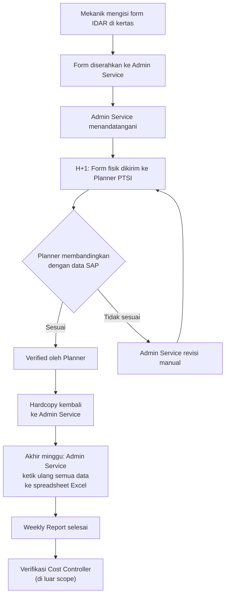
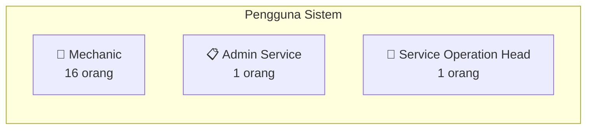
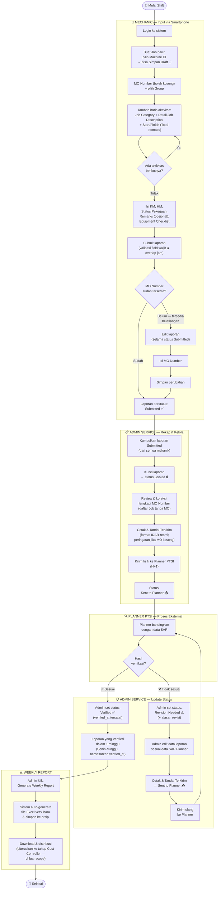
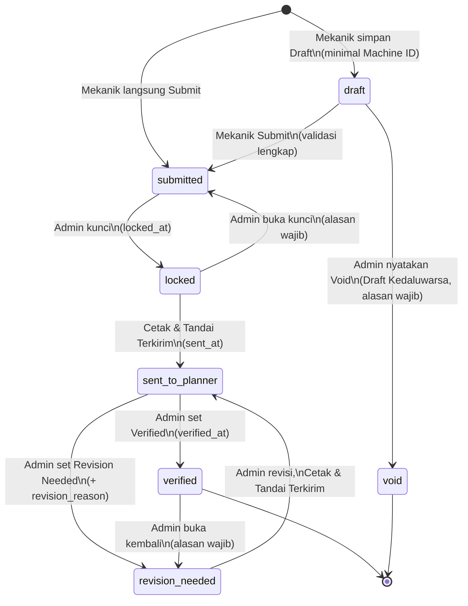
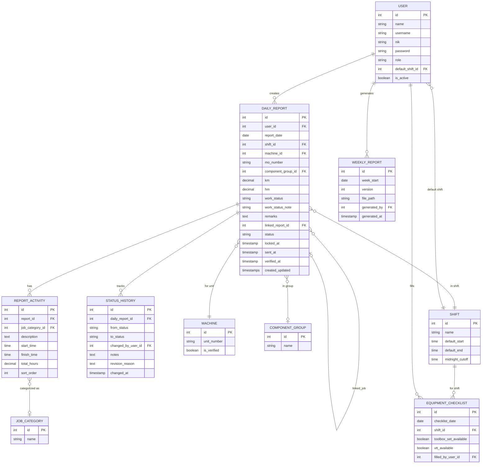

# PRD — Aplikasi Daily Routine
## PT IndoTruck Utama

| Metadata | Detail |
|---|---|
| **Versi Dokumen** | 1.2 |
| **Tanggal** | 20 Oktober 2026 |
| **Penulis** | Business Analyst / Product Manager |
| **Status** | Draft — Revisi 2 |
| **Pemohon** | Service Operation Head, PT IndoTruck Utama |
| **Model Pengembangan** | Tim kecil (1 atau lebih developer) — pendekatan AI-Assisted |

---

## Daftar Isi

1. [Executive Summary](#1-executive-summary)
2. [Problem Statement & Background](#2-problem-statement--background)
3. [Goals & Objectives](#3-goals--objectives)
4. [Scope & Out of Scope](#4-scope--out-of-scope)
5. [User Roles & Permissions](#5-user-roles--permissions)
6. [User Flow / Business Process Flow](#6-user-flow--business-process-flow)
7. [Functional Requirements](#7-functional-requirements)
8. [Data Model Overview](#8-data-model-overview)
9. [Non-Functional Requirements](#9-non-functional-requirements)
10. [Assumptions & Open Questions](#10-assumptions--open-questions)
11. [Tech Stack Summary](#11-tech-stack-summary)
12. [Appendix — Daftar Istilah](#12-appendix--daftar-istilah)

---

## 1. Executive Summary

PT IndoTruck Utama mengoperasikan layanan perawatan dan perbaikan unit kendaraan berat dengan sistem 3 shift per hari (Morning, Evening, Overnight), masing-masing diisi oleh 2 mekanik. Saat ini, seluruh proses pelaporan kerja harian mekanik masih bersifat **manual berbasis kertas** — mulai dari pengisian form "Individual Daily Activity Report" (IDAR), pengiriman fisik ke Planner eksternal (PTSI) untuk verifikasi, hingga penyusunan Weekly Report yang diketik ulang satu per satu ke spreadsheet oleh satu-satunya Admin Service.

**Aplikasi "Daily Routine"** dirancang untuk mendigitalisasi seluruh alur ini: mekanik menginput laporan kerja real-time via smartphone (satu **Job** per unit dan Group, berisi satu atau lebih **baris aktivitas** dengan waktunya masing-masing), Admin Service merekap dan mencetak dalam format form IDAR resmi untuk dikirim ke Planner, tracking status verifikasi dilakukan di dalam sistem, dan **Weekly Report di-generate otomatis** dari data yang sudah terverifikasi — menghilangkan proses ketik ulang manual yang memakan waktu dan rawan error.

Proyek ini dikerjakan oleh **tim pengembang kecil** (1 atau lebih developer) menggunakan pendekatan AI-assisted dengan tech stack **Laravel + Filament + Livewire**.

---

## 2. Problem Statement & Background

### 2.1 Kondisi Saat Ini (As-Is)

> [!NOTE]
> Weekly Report kemungkinan besar menjadi dokumen yang diteruskan ke tahap Cost Controller. Karena itu, **akurasi Weekly Report sangat penting** — kesalahan di Weekly Report berpotensi terbawa ke tahap berikutnya.

### 2.2 Pain Points

| # | Pain Point | Dampak |
|---|---|---|
| 1 | **Weekly Report diketik ulang manual**, dikerjakan oleh 1 orang Admin Service | Memakan waktu sangat lama, rawan salah ketik, bottleneck operasional |
| 2 | Form kertas bisa hilang, rusak, atau tidak terbaca | Data tidak reliable, proses verifikasi terhambat |
| 3 | Siklus revisi Planner berulang tanpa tracking | Tidak ada visibilitas status — laporan mana yang sudah Verified, mana yang masih Revision |
| 4 | Format penulisan tidak konsisten antar mekanik | Admin Service harus menginterpretasi ulang tulisan tangan |
| 5 | Tidak ada dashboard untuk monitoring produktivitas mekanik | Service Operation Head tidak punya visibilitas real-time |

### 2.3 Masalah Utama yang Harus Diselesaikan

> [!IMPORTANT]
> **Pain point #1 adalah prioritas tertinggi**: Menghilangkan proses ketik ulang manual Weekly Report. Sistem HARUS mampu auto-generate file Excel dengan format yang sesuai standar perusahaan dari data laporan harian yang sudah berstatus Verified.

---

## 3. Goals & Objectives

### 3.1 Goals

| # | Goal | Deskripsi |
|---|---|---|
| G1 | Digitalisasi laporan harian mekanik | Mekanik menginput laporan via smartphone secara real-time, menggantikan form kertas |
| G2 | Otomasi pembuatan Weekly Report | Sistem auto-generate file Excel sesuai format standar perusahaan dari data Verified |
| G3 | Tracking status verifikasi Planner | Admin Service dapat melacak status setiap laporan (Draft → Submitted → Locked → Sent to Planner → Verified / Revision Needed) di dalam sistem |
| G4 | Dashboard monitoring jam kerja | Service Operation Head dan Admin Service dapat melihat total jam kerja per mekanik secara visual |

### 3.2 Metrik Keberhasilan

> [!NOTE]
> Seluruh metrik di bawah ini adalah **usulan, belum divalidasi stakeholder**.

| # | Metrik | Target | Cara Ukur |
|---|---|---|---|
| M1 | Waktu pembuatan Weekly Report | Berkurang dari **berjam-jam → < 5 menit** (termasuk review sebelum kirim) | Perbandingan waktu sebelum & sesudah implementasi |
| M2 | Tingkat adopsi mekanik | **100% mekanik** (16 orang) aktif menginput laporan via sistem dalam 2 minggu pertama | Jumlah user aktif vs total mekanik |
| M3 | Pengurangan siklus revisi | Revisi karena **kesalahan format/ketik** berkurang signifikan | Jumlah Revision Needed yang disebabkan error format. **Catatan:** pengukuran ini membutuhkan data alasan revisi — karena itu tersedia field `revision_reason` pada Status History saat status diubah ke `revision_needed` (lihat FR-VRF-09) |
| M4 | Zero paper dependency untuk internal recording | Semua data laporan tersimpan digital, kertas hanya untuk pengiriman ke Planner | Observasi proses operasional |

---

## 4. Scope & Out of Scope

### 4.1 In Scope (V1)

| # | Fitur / Area | Keterangan |
|---|---|---|
| 1 | Input laporan harian mekanik via web (mobile-friendly) | Form digital pengganti IDAR kertas: Job (header) + baris aktivitas, termasuk simpan sebagai Draft (input real-time) |
| 2 | Manajemen master data | Machine/Unit (±192 nomor unit, termasuk import Excel/CSV dan verifikasi unit baru dari mekanik), Group (komponen), Job Category, data mekanik, shift |
| 3 | Rekap & cetak laporan oleh Admin Service | Kumpulkan laporan per hari, kunci, lengkapi MO Number, cetak dalam format identik template IDAR resmi untuk dikirim ke Planner |
| 4 | Tracking status verifikasi Planner | Admin Service update status manual (Verified / Revision Needed) |
| 5 | Siklus revisi laporan | Admin Service edit data → kirim ulang → sampai Verified |
| 6 | Auto-generate Weekly Report (Excel) | Format sesuai template standar perusahaan, dengan versi per minggu dan arsip seluruh versi |
| 7 | Dashboard jam kerja mekanik | Bar chart harian/mingguan, untuk Admin Service & Service Operation Head |
| 8 | Role-based access control | Mechanic, Admin Service, Service Operation Head |

### 4.2 Out of Scope (TIDAK termasuk V1)

> [!CAUTION]
> Item-item berikut secara eksplisit **TIDAK** termasuk dalam scope proyek ini.

| # | Item | Alasan |
|---|---|---|
| 1 | **Tahap Cost Controller** | Di luar alur yang diminta stakeholder — proses setelah Weekly Report dibuat ditangani terpisah |
| 2 | Akses sistem untuk Planner (PTSI) | Planner adalah pihak eksternal yang tidak akan menggunakan sistem ini |
| 3 | Notifikasi (WhatsApp / Email / In-App) | Tidak diperlukan untuk V1 |
| 4 | Tanda tangan digital | Tidak diminta oleh stakeholder — tanda tangan tetap fisik di hasil cetak |
| 5 | Integrasi langsung dengan SAP | Tidak ada akses API SAP, data MO Number diinput manual |
| 6 | Fitur komentar / approval oleh Service Operation Head | Role ini hanya view-only |
| 7 | Multi-tenant / multi-cabang | Sistem hanya untuk 1 lokasi operasional |
| 8 | **Modul Request Order (RO)** — penerbitan RO dan pencatatan nomor RO | Tidak diminta untuk V1. Mekanik tetap menerima informasi unit & Group dari RO di luar sistem. Kandidat fase berikutnya (Bagian 4.3) |

### 4.3 Future Work (Kandidat Fase Berikutnya)

| # | Item | Catatan |
|---|---|---|
| FW-01 | Modul Request Order (RO): penerbitan RO dan pencatatan nomor RO di sistem | Saat ini RO di luar scope V1 (Bagian 4.2 #8). Perlu analisis kebutuhan terpisah |

---

## 5. User Roles & Permissions

### 5.1 Ringkasan Role

### 5.2 Detail Hak Akses

#### 5.2.1 Mechanic (16 user)

| Area | Hak Akses | Catatan |
|---|---|---|
| Laporan harian | **Create, Read, Update (terbatas)** | Bisa membuat & melihat laporan (Job beserta baris aktivitasnya) miliknya sendiri, termasuk menyimpan sebagai Draft |
| Edit laporan sendiri | **Ya, HANYA saat status `draft` atau `submitted`** | Terutama untuk menyelesaikan Draft dan menambahkan MO Number yang baru tersedia setelah pekerjaan dimulai |
| Edit laporan setelah dikunci | **Tidak** | Mulai status `locked` dan seterusnya, mekanik tidak bisa mengedit (termasuk MO Number) |
| Remarks | **Isi & edit** | Selama status `draft` atau `submitted` |
| Lihat laporan mekanik lain | **Tidak** | Hanya melihat laporan milik sendiri |
| Machine / Unit baru | **Tambah (terbatas)** | Hanya jika unit tidak ditemukan di master data; unit tersimpan sebagai "belum terverifikasi" |
| Master data | **Tidak ada akses** (selain penambahan unit baru di atas) | — |
| Dashboard | **Tidak ada akses** | — |
| Weekly Report | **Tidak ada akses** | — |

#### 5.2.2 Admin Service (1 user)

| Area | Hak Akses | Catatan |
|---|---|---|
| Laporan harian | **Read semua, Edit (terbatas status), Cetak** | Bisa melihat laporan SEMUA mekanik. Edit hanya saat status `locked` atau `revision_needed` |
| MO Number | **Isi & edit** | Saat status `locked` atau `revision_needed` — karena MO Number shift Evening/Overnight sering baru tersedia setelah laporan dikunci. Tersedia daftar "Job tanpa MO Number" |
| Remarks | **Isi & edit** | Saat status `locked` atau `revision_needed` |
| Status laporan | **Update** | Mengunci, membuka kunci (alasan wajib), Cetak & Tandai Terkirim, Verified / Revision Needed, membuka kembali laporan Verified (alasan wajib), menyatakan Void untuk Draft Kedaluwarsa (alasan wajib) |
| Revisi laporan | **Edit & Re-submit** | Mengedit konten laporan berdasarkan data SAP dari Planner, lalu Cetak & Tandai Terkirim kembali |
| Master data | **Full CRUD** | Mengelola: Machine/Unit (termasuk import Excel/CSV dan verifikasi unit baru dari mekanik), Group, Job Category, data mekanik, shift |
| Dashboard | **View** | Melihat total jam kerja per mekanik (harian/mingguan) |
| Weekly Report | **Generate, View & Download** | Auto-generate file Excel untuk periode mingguan (versi baru setiap generate), unduh ulang semua versi dari arsip |
| Manajemen user | **Create & manage akun mekanik, reset password** | Reset password dilakukan oleh Admin Service (tanpa email) |

#### 5.2.3 Service Operation Head (1 user)

> Role ini bersifat **VIEW-ONLY penuh** — dapat melihat seluruh area di bawah, tanpa hak edit sama sekali.

| Area | Hak Akses | Catatan |
|---|---|---|
| Dashboard | **View-only** | Melihat total jam kerja per mekanik (harian/mingguan), bar chart |
| Laporan harian | **View-only** | Bisa melihat semua laporan harian, TIDAK bisa edit |
| Status verifikasi | **View-only** | Bisa melihat status semua laporan, TIDAK bisa mengubah |
| Master data | **View-only** | Bisa melihat data master, TIDAK bisa edit |
| Weekly Report | **View & Download** | Bisa melihat & download Weekly Report yang sudah di-generate (termasuk seluruh versi di arsip) |
| Komentar / Approval | **TIDAK ADA** | Role ini murni monitoring |

---

## 6. User Flow / Business Process Flow

### 6.1 Alur End-to-End (To-Be)

### 6.2 Alur Input Laporan Mekanik (Detail)

Laporan disusun sebagai **Job (header)** yang berisi satu atau lebih **baris aktivitas**. Satu Job = satu unit pada satu Group dalam satu shift. Urutan kolom di form input dan tabel di layar: **Machine ID | MO Number | Group | Job Category | Detail Job Description | Time (Start/Finish) | Total**.

1. Mekanik **login** ke sistem via browser HP (Android) menggunakan **username atau NIK** dan password.
2. Masuk ke halaman **"Laporan Harian"**. Di halaman ini mekanik juga melihat **daftar Draft miliknya yang belum selesai** (dikenali dari Machine ID).
3. Klik **"Tambah Laporan Baru"**. Sistem otomatis mengisi: **nama mekanik** (dari akun login), **shift** (bisa dipilih: Morning / Evening / Overnight), dan **tanggal laporan (`report_date`) = tanggal MULAI SHIFT**. Default tanggal: tanggal hari ini; **khusus jika shift = Overnight dan waktu pengisian sebelum 07:00, default = tanggal kemarin**. Mekanik tetap bisa mengubah tanggal secara manual.
4. Mekanik mengisi header Job:
   1. **Machine ID / Unit Number** — pilih dari master data (informasi unit sudah diketahui mekanik dari Request Order/RO). Jika unit tidak ditemukan, mekanik dapat **menambahkan unit baru** yang akan ditandai "belum terverifikasi". Setelah Machine ID dipilih, Job sudah bisa disimpan sebagai **Draft**.
   2. **MO Number** — boleh dikosongkan. MO Number ditentukan oleh Planner dan biasanya baru tersedia sekitar jam 12 siang, sehingga hampir selalu diisi setelah pekerjaan dimulai (bahkan setelah shift berakhir).
   3. **Group** — pilih satu Group komponen (mis. Engine, Brake, Transmission). Jika unit yang sama dikerjakan di dua Group, mekanik membuat **dua Job terpisah**.
5. Mekanik menambah **baris aktivitas**:
   - **Job Category** — pilih satu (mis. Troubleshooting, Replace).
   - **Detail Job Description** — teks bebas yang diketik mekanik (boleh beberapa baris/poin).
   - **Start / Finish** — time picker. Saat mulai aktivitas, mekanik boleh hanya mengisi Start lalu Simpan Draft; Finish diisi saat aktivitas selesai.
   - **Total** — dihitung otomatis per baris: Finish − Start dalam jam (2 desimal); jika Finish < Start (melewati tengah malam) ditambah 24 jam; Finish 00:00 = 24:00 (lihat FR-RPT-15).
6. Setelah satu aktivitas selesai, mekanik **menambah baris berikutnya** dengan Job Category berikutnya beserta waktunya sendiri. Job Category yang sama boleh dipakai lagi di baris lain dalam Job yang sama.
7. Mekanik mengisi sisa header: **KM**, **HM**, **Status Pekerjaan** (Selesai / Pending - Waiting Part / Pending - Over Handle Job / Pending - Waiting Bays / Others; jika **"Others"** → catatan WAJIB), **Linking Job** (opsional), dan **Remarks** (opsional).
8. **Equipment Checklist** — diisi **1× per shift** (bukan per mekanik): Toolbox Set (Portable) ✓/✗, Volvo Tech Tool (VTT) ✓/✗.
9. Klik **"Submit"** → sistem memvalidasi seluruh field wajib (Bagian 7.1.1) dan memastikan rentang waktu baris aktivitas **tidak bertabrakan (overlap)** dengan baris aktivitas lain milik mekanik yang sama → status laporan = **Submitted**.
10. Mekanik BISA membuat Job lain untuk unit/Group lain di shift yang sama.

> [!NOTE]
> **Contoh skenario.** Mekanik shift Morning menerima RO untuk unit **[nomor unit]** dengan Group **Engine**. MO Number belum tersedia.
>
> | Machine ID | MO Number | Group | Job Category | Detail Job Description | Time (Start/Finish) | Total |
> |---|---|---|---|---|---|---|
> | [nomor unit] | *(kosong)* | Engine | Troubleshooting | Cek penyebab mesin sulit hidup; pemeriksaan sistem bahan bakar | 08:00 – 09:30 | 1,50 |
> | | | | Replace | Ganti filter bahan bakar; tes hidupkan mesin | 09:45 – 11:00 | 1,25 |
> | | | | | | **Total Job** | **2,75** |
>
> Mekanik membuat Job dengan Machine ID dan Group Engine, menambah baris **Troubleshooting** dengan waktunya, lalu setelah selesai menambah baris **Replace** dengan waktunya sendiri. Setelah mengisi KM, HM, dan Status Pekerjaan, mekanik Submit. Sekitar jam 12, MO Number dari Planner tersedia dan mekanik mengisinya selama laporan masih Submitted (atau Admin Service mengisinya jika laporan sudah Locked).

### 6.3 Alur Rekap & Cetak oleh Admin Service

1. Admin Service membuka halaman **"Rekap Harian"**.
2. Filter berdasarkan **tanggal** dan/atau **shift**. Tersedia juga filter **"Job tanpa MO Number"**.
3. Melihat daftar semua laporan yang berstatus **Submitted**.
4. **Kunci laporan** → status berubah menjadi **Locked** (`locked_at` tercatat). Setelah dikunci, mekanik TIDAK bisa lagi mengedit. Jika perlu, Admin Service dapat **membuka kunci** kembali ke Submitted dengan **alasan wajib** (tercatat di Status History).
5. Review isi laporan — **TANPA mengubah konten** (kecuali ada kesalahan yang perlu dikoreksi sebelum cetak; Admin Service dapat mengedit laporan berstatus Locked, termasuk **melengkapi MO Number** dan mengisi Remarks).
6. Pilih laporan yang akan dicetak:
   - **Default**: 1 Job dicetak pada lembar tersendiri (1 form).
   - **Opsi toggle**: Gabungkan beberapa Job dalam 1 lembar cetak (hemat kertas), selama muat.
   - Jika isi satu Job melebihi kapasitas baris template, dilanjutkan ke lembar berikutnya dengan header diulang (FR-RKP-08).
7. Klik **"Cetak & Tandai Terkirim"** → sistem menghasilkan file cetak dengan format **identik template IDAR_2026.xlsx**. Jika ada Job tanpa MO Number, sistem menampilkan **peringatan** (tidak memblokir). Setelah Admin Service mengonfirmasi, status berubah menjadi **"Sent to Planner"** (`sent_at` tercatat). Cetak fisik dan kirim ke Planner.
8. **"Cetak Ulang"** tersedia untuk mencetak kembali tanpa mengubah status.
9. Admin Service juga memantau daftar **"Draft Kedaluwarsa"**: Draft yang tidak di-submit hingga lebih dari 24 jam setelah shift berakhir. Admin Service dapat menyatakan Draft tersebut **Void** dengan **alasan wajib** (tanpa mengedit isinya). Laporan Void tidak ikut dashboard maupun Weekly Report.

### 6.4 Alur Manajemen Status Verifikasi

1. Planner PTSI melakukan verifikasi di luar sistem (bandingkan laporan cetak vs data SAP mereka).
2. Planner menyampaikan hasil ke Admin Service via telepon / WhatsApp / tatap muka.
3. Admin Service membuka halaman **"Verifikasi Planner"** di sistem.
4. Untuk setiap laporan yang berstatus **"Sent to Planner"**, Admin Service memilih:
   - ✅ **Verified** — Laporan sesuai, proses selesai (untuk scope ini). `verified_at` tercatat.
   - ⚠️ **Revision Needed** — Laporan perlu direvisi. Admin Service mengisi **alasan revisi** (`revision_reason`).
5. Jika **Revision Needed**:
   - Laporan menjadi **editable kembali** untuk Admin Service (BUKAN untuk mekanik).
   - Admin Service merevisi data sesuai informasi dari Planner (berdasarkan data SAP).
   - Setelah revisi, Admin Service menekan **"Cetak & Tandai Terkirim"** → status kembali ke **"Sent to Planner"**.
   - Kirim ulang ke Planner → tunggu verifikasi ulang.
   - Siklus berulang sampai **Verified**.
6. Laporan **Verified** dapat **dibuka kembali** oleh Admin Service menjadi **Revision Needed** dengan **alasan wajib** (tercatat di Status History). Saat Verified ulang, `verified_at` diperbarui dan laporan ikut Weekly Report pada minggu `verified_at` yang baru. File Weekly Report yang sudah di-generate sebelumnya **tidak berubah**.

#### 6.4.1 Diagram Status Laporan

Status laporan dikelola dengan **satu enum `status`**: `draft`, `submitted`, `locked`, `sent_to_planner`, `verified`, `revision_needed`, `void`.

| Status | Mekanik boleh edit? | Admin Service boleh edit? |
|---|---|---|
| `draft` | ✅ Ya | ❌ Tidak |
| `submitted` | ✅ Ya | ❌ Tidak |
| `locked` | ❌ Tidak | ✅ Ya (termasuk MO Number) |
| `sent_to_planner` | ❌ Tidak | ❌ Tidak |
| `revision_needed` | ❌ Tidak | ✅ Ya (termasuk MO Number) |
| `verified` | ❌ Tidak | ❌ Tidak |
| `void` | ❌ Tidak | ❌ Tidak |

### 6.5 Alur Generate Weekly Report

1. Admin Service membuka halaman **"Weekly Report"**.
2. Pilih **periode minggu** (Senin–Minggu).
3. Sistem menampilkan **preview**: **semua** laporan berstatus Verified yang **`verified_at`-nya jatuh pada minggu tersebut**.
4. Laporan yang BELUM Verified di akhir minggu **TIDAK dimasukkan** — ditunda ke minggu saat laporan tersebut Verified.
5. Di dalam sheet, **satu baris data = satu baris aktivitas**; kolom NO tetap indeks Job. Baris diurutkan berdasarkan **`report_date` (tanggal kerja asli)** lalu **shift**; kolom DATE tetap menampilkan tanggal kerja asli.
6. Klik **"Generate Excel"** → sistem membuat file Excel dengan format standar perusahaan (Daily.xlsx) sebagai **versi baru** untuk minggu tersebut (v1, v2, ...) dan menyimpannya ke **arsip**. Versi sebelumnya tetap tersimpan dan tidak berubah.
7. Download file Excel. Seluruh versi Weekly Report yang pernah di-generate dapat **diunduh ulang** kapan saja dari arsip.

---

## 7. Functional Requirements

### 7.1 Modul: Input Laporan Harian Mekanik

| ID | Requirement | Prioritas | Catatan |
|---|---|---|---|
| FR-RPT-01 | Mekanik dapat membuat **Job** (header laporan) untuk 1 unit pada 1 Group. Setiap Job memiliki satu atau lebih **baris aktivitas** | **MUST** | Setiap Job terikat pada 1 mekanik, 1 tanggal (`report_date`), 1 shift |
| FR-RPT-02 | Header Job menyediakan field: Machine ID, MO Number, Group, KM, HM, Status Pekerjaan, Linking Job, Remarks. Setiap baris aktivitas menyediakan field: Job Category, Detail Job Description, Start, Finish, Total (auto) | **MUST** | Detail validasi per field lihat Bagian 7.1.1 |
| FR-RPT-03 | MO Number (diketik, numerik) BOLEH dikosongkan saat submit awal. Mekanik dapat mengisinya saat status `draft`/`submitted`; Admin Service dapat mengisi/mengubahnya saat status `locked` atau `revision_needed` | **MUST** | MO Number ditentukan Planner, biasanya tersedia sekitar jam 12 siang — sering setelah shift berakhir atau setelah laporan dikunci (terutama shift Evening/Overnight). Asumsi 1 MO Number per Job (OQ-23) |
| FR-RPT-04 | Mekanik HANYA bisa melihat & mengedit laporan milik sendiri | **MUST** | Tidak bisa melihat laporan mekanik lain |
| FR-RPT-05 | Mekanik BISA mengedit laporan sendiri HANYA selama status `draft` atau `submitted` | **MUST** | Setelah status berubah ke `locked` (dan seterusnya), mekanik tidak bisa edit lagi |
| FR-RPT-06 | Jika 2 mekanik mengerjakan unit yang sama dalam 1 shift, TETAP dicatat sebagai 2 Job terpisah | **MUST** | Masing-masing mekanik submit laporan atas namanya sendiri |
| FR-RPT-07 | Linking Job (opsional): mekanik BISA menautkan Job baru ke Job sebelumnya yang berstatus Pending pada unit yang sama | **SHOULD** | Agar riwayat pekerjaan yang dilanjutkan tersambung sebagai 1 thread |
| FR-RPT-08 | Form HARUS mobile-friendly dan bisa diakses via browser HP Android | **MUST** | Mekanik menginput real-time saat bekerja |
| FR-RPT-09 | Mekanik dapat menyimpan Job sebagai **Draft** dengan minimal **Machine ID** terisi; field lain opsional. Baris aktivitas pada Draft boleh hanya berisi Start (Finish kosong). Seluruh field wajib baru divalidasi saat tombol **Submit** ditekan | **MUST** | Machine ID diperlukan agar Draft dapat dikenali di daftar Draft |
| FR-RPT-10 | Mekanik dapat melihat **daftar Draft miliknya yang belum selesai** dan melanjutkan pengisiannya | **MUST** | — |
| FR-RPT-11 | Sistem menolak penyimpanan jika rentang waktu (Start–Finish) suatu baris aktivitas **bertabrakan (overlap)** dengan baris aktivitas lain milik mekanik yang sama — baik dalam Job yang sama maupun Job lain — dengan memperhitungkan aktivitas yang melewati tengah malam | **MUST** | Agar total jam di dashboard dan Weekly Report tidak terhitung ganda. Berlaku untuk penyimpanan oleh mekanik maupun Admin Service. Penentuan tanggal kalender mengikuti FR-RPT-20 |
| FR-RPT-12 | `report_date` = **tanggal MULAI SHIFT**, bukan tanggal saat laporan diisi. Default di form: jika shift = Overnight dan waktu pengisian sebelum 07:00, default = tanggal kemarin; selain itu tanggal hari ini. Mekanik dapat mengubah secara manual | **MUST** | Contoh: aktivitas overnight yang mulai 04:00 tanggal 7 tetap tercatat `report_date` tanggal 6 jika shift-nya dimulai tanggal 6 malam |
| FR-RPT-13 | Jika Machine ID / Unit Number tidak ditemukan di master data, mekanik dapat **menambahkan unit baru**. Unit tersebut tersimpan dengan `is_verified = false` ("belum terverifikasi") | **MUST** | Agar pekerjaan tidak terblokir. Admin Service memverifikasi/merapikan kemudian (FR-MDM-07) |
| FR-RPT-14 | Field **Remarks** (teks bebas, opsional, level Job) dapat diisi oleh mekanik (status `draft`/`submitted`) dan Admin Service (status `locked`/`revision_needed`) | **MUST** | Dipetakan ke kolom "Remarks" di Weekly Report Excel |
| FR-RPT-15 | **Total per baris aktivitas** = selisih Finish − Start dalam satuan jam, desimal 2 digit. Jika Finish < Start (melewati tengah malam), ditambah 24 jam. Finish 00:00 dengan Start > 00:00 diperlakukan sebagai 24:00. **Finish = Start ditolak** | **MUST** | Keputusan final. Contoh: 23:00 s.d. 03:30 = 4,50 jam; 20:00 s.d. 00:00 = 4,00 jam; 08:00 s.d. 08:00 = ditolak |
| FR-RPT-16 | Mekanik dapat **menambah, mengubah, menghapus, dan mengurutkan** baris aktivitas dalam satu Job. Setiap baris memiliki **tepat 1 Job Category**; Job Category yang sama boleh dipakai berulang di baris lain dalam Job yang sama | **MUST** | Urutan disimpan di `sort_order`. Asumsi 1 baris = 1 Job Category (OQ-24) |
| FR-RPT-17 | **Total jam Job** = jumlah Total seluruh baris aktivitasnya (dihitung sistem, read-only). **Start Job** = Start baris pertama, **Finish Job** = Finish baris terakhir (turunan, hanya untuk tampilan/cetak) | **MUST** | — |
| FR-RPT-18 | **Group** dipilih sebagai **single select** di level Job (header). Jika satu unit dikerjakan di dua Group, mekanik membuat dua Job terpisah | **MUST** | Pilihan dari master data Group (FR-MDM-08) |
| FR-RPT-19 | Urutan kolom di form input dan tabel di layar: **Machine ID \| MO Number \| Group \| Job Category \| Detail Job Description \| Time (Start/Finish) \| Total** | **MUST** | — |
| FR-RPT-20 | Penentuan **tanggal kalender** suatu jam pada shift **Overnight**: jam < cut-off dianggap terjadi pada `report_date` + 1 hari; jam ≥ cut-off pada `report_date`. Cut-off disimpan di master Shift (`midnight_cutoff`, default 12:00) | **MUST** | Digunakan untuk validasi overlap (FR-RPT-11) dan urutan aktivitas di dalam shift. Contoh: shift Overnight `report_date` 6, aktivitas 04:00 → tanggal kalender 7 |

#### 7.1.1 Validasi Field Laporan

**a. Header Job**

| Field | Tipe Input | Validasi | Wajib saat Draft? | Wajib saat Submit? |
|---|---|---|---|---|
| **Machine ID / Unit Number** | Text / Autocomplete dari master data | Dipilih dari master data. Jika belum ada, mekanik dapat menambahkan unit baru (tersimpan `is_verified = false`) | ✅ Wajib | ✅ Wajib |
| **MO Number** | Numerik (diketik) | Format numerik, panjang digit TBD (lihat OQ-02) | ❌ Tidak | ❌ Opsional, bisa ditambahkan kemudian (oleh mekanik atau Admin Service, lihat FR-RPT-03) |
| **Group** | Single-select dropdown | Pilihan dari master data Group, diurutkan alfabetis | ❌ Tidak | ✅ Wajib |
| **KM (Kilometer)** | Numerik | Bilangan positif | ❌ Tidak | ✅ Wajib |
| **HM (Hour Meter)** | Numerik | Bilangan positif (bisa desimal) | ❌ Tidak | ✅ Wajib |
| **Status Pekerjaan** | Single-select dropdown | Pilihan: Selesai, Pending - Waiting Part, Pending - Over Handle Job, Pending - Waiting Bays, Others | ❌ Tidak | ✅ Wajib |
| **Catatan Status "Others"** (`work_status_note`) | Text area | WAJIB diisi jika Status Pekerjaan = "Others". Hanya dipakai untuk status "Others" | ❌ Tidak | Kondisional |
| **Linking Job** | Select / search dari Job sebelumnya (unit yang sama, status Pending) | Opsional, hanya tampil jika ada Job Pending di unit yang sama | ❌ Tidak | ❌ Opsional |
| **Remarks** | Text area | Teks bebas | ❌ Tidak | ❌ Opsional |
| **Baris aktivitas** | Daftar baris (lihat tabel b) | Minimal 1 baris aktivitas lengkap (Job Category, Detail Job Description, Start, Finish) | ❌ Tidak | ✅ Wajib (minimal 1 baris lengkap). Perlakuan baris tambahan yang belum lengkap lihat OQ-25 |

**b. Baris Aktivitas**

| Field | Tipe Input | Validasi | Wajib saat Draft? | Wajib saat Submit? |
|---|---|---|---|---|
| **Job Category** | Single-select dropdown | Pilihan dari master data Job Category, diurutkan alfabetis. Tepat 1 per baris; boleh sama dengan baris lain | ❌ Tidak | ✅ Wajib |
| **Detail Job Description** | Text area (teks bebas) | Diketik mekanik; boleh beberapa baris/poin | ❌ Tidak | ✅ Wajib |
| **Start** | Time picker | WAJIB via time picker, BUKAN input teks manual. Tidak boleh berada di dalam rentang baris aktivitas lain milik mekanik yang sama | ❌ Tidak | ✅ Wajib |
| **Finish** | Time picker | WAJIB via time picker, BUKAN input teks manual. Boleh lebih kecil dari Start (dianggap melewati tengah malam, +24 jam). Finish 00:00 dengan Start > 00:00 = 24:00. **Tidak boleh sama dengan Start.** Rentang Start–Finish tidak boleh overlap dengan baris aktivitas lain milik mekanik yang sama | ❌ Tidak (boleh kosong saat Draft) | ✅ Wajib |
| **Total** | Auto-calculated, read-only | Finish − Start dalam jam (2 desimal); +24 jam jika Finish < Start (lihat FR-RPT-15) | Auto (jika Finish terisi) | ✅ Auto (tidak diinput) |

### 7.2 Modul: Equipment Checklist

| ID | Requirement | Prioritas | Catatan |
|---|---|---|---|
| FR-EQP-01 | Equipment Checklist diisi **1 kali per shift**, BUKAN per mekanik individual | **MUST** | Karena alat dipakai bersama dalam 1 shift. Tanggal checklist mengikuti tanggal mulai shift (sama dengan aturan `report_date`); shift merujuk ke master Shift |
| FR-EQP-02 | Item checklist: "Toolbox Set (Portable)" dan "Volvo Tech Tool (VTT)" | **MUST** | Format: tersedia (✓) / tidak tersedia (✗) |
| FR-EQP-03 | Checklist bisa diisi oleh mekanik MANAPUN yang pertama kali submit laporan di shift tersebut | **SHOULD** | Mekanik kedua di shift yang sama melihat checklist sudah terisi |
| FR-EQP-04 | Checklist bisa diedit oleh salah satu mekanik di shift tersebut sebelum laporan dikunci | **SHOULD** | — |

### 7.3 Modul: Rekap & Cetak oleh Admin Service

| ID | Requirement | Prioritas | Catatan |
|---|---|---|---|
| FR-RKP-01 | Admin Service dapat melihat daftar semua laporan, difilter per tanggal dan/atau shift | **MUST** | — |
| FR-RKP-02 | Admin Service dapat **mengunci** laporan berstatus `submitted` yang sudah siap dikirim ke Planner → status menjadi `locked`, `locked_at` diisi | **MUST** | Setelah dikunci, mekanik tidak bisa mengedit lagi; Admin Service masih bisa mengedit untuk koreksi sebelum cetak (termasuk MO Number) |
| FR-RKP-03 | Admin Service dapat mencetak laporan dengan 2 mode: (a) 1 Job pada lembar tersendiri, (b) beberapa Job digabung dalam 1 lembar (toggle opsional) selama muat dalam kapasitas baris template | **MUST** | Opsi gabung untuk menghemat kertas |
| FR-RKP-04 | Hasil cetak harus **SAMA PERSIS** dengan format file **IDAR_2026.xlsx** (template resmi perusahaan); file cetak dihasilkan dengan mengisi template tersebut. Aturan pengisian (asumsi, lihat OQ-07): Machine ID dan MO Number dicetak di baris pertama Job; tiap baris aktivitas dicetak sebagai baris/poin deskripsi, dengan Start di baris pertama aktivitas serta Finish dan Total di baris terakhir aktivitas tersebut. **Group dan Job Category TIDAK dicetak** (IDAR tidak memiliki kolomnya; tetap tersimpan di sistem, lihat OQ-21). KM, HM, Status Pekerjaan ditempatkan sesuai bagian bawah template; Equipment Checklist dan blok tanda tangan (Mechanic, Supervisor, Section Head, "Checked By PTSI Workshop Direct Superior") mengikuti template | **MUST** | Metode teknis pengisian template diputuskan di dokumen Architecture (AR-03) |
| FR-RKP-05 | Status laporan berubah menjadi **`sent_to_planner`** HANYA melalui aksi **"Cetak & Tandai Terkirim"**: satu aksi yang menghasilkan file cetak lalu meminta konfirmasi Admin Service. Setelah dikonfirmasi, `sent_at` diisi | **MUST** | Berlaku untuk transisi `locked` → `sent_to_planner` maupun `revision_needed` → `sent_to_planner` |
| FR-RKP-06 | Admin Service dapat **"Cetak Ulang"** laporan **tanpa mengubah status** | **MUST** | Mis. jika hasil cetak hilang atau rusak |
| FR-RKP-07 | Service Operation Head dapat **melihat** (view-only) semua laporan harian | **MUST** | Tanpa hak edit, kunci, atau mengubah status |
| FR-RKP-08 | **Aturan overflow cetak**: jika isi satu Job melebihi kapasitas baris tabel template IDAR (±20 baris di form kertas — diverifikasi terhadap file template), cetakan dilanjutkan ke lembar berikutnya dengan header (nama, tanggal, shift) diulang | **MUST** | Kapasitas pasti mengikuti IDAR_2026.xlsx (OQ-07) |
| FR-RKP-09 | Admin Service dapat melihat daftar/filter **"Job tanpa MO Number"** untuk dilengkapi sebelum dikirim ke Planner | **SHOULD** | — |
| FR-RKP-10 | Saat Admin Service menjalankan "Cetak & Tandai Terkirim" untuk Job tanpa MO Number, sistem menampilkan **peringatan** (bukan blokir) | **SHOULD** | Lihat OQ-23 |
| FR-RKP-11 | Admin Service dapat **membuka kunci** laporan `locked` kembali ke `submitted` dengan **alasan wajib**, tercatat di Status History | **MUST** | Setelah dibuka kunci, mekanik dapat mengedit kembali |
| FR-RKP-12 | Sistem menampilkan daftar **"Draft Kedaluwarsa"** kepada Admin Service: Draft yang tidak di-submit hingga **lebih dari 24 jam setelah shift berakhir**. Admin Service dapat menyatakan Draft tersebut **`void`** dengan **alasan wajib** (tanpa mengedit isinya), tercatat di Status History | **MUST** | Waktu berakhirnya shift dihitung dari `report_date` dan jam selesai default di master Shift. Laporan `void` tidak ikut dashboard maupun Weekly Report |

### 7.4 Modul: Manajemen Status Verifikasi Planner

| ID | Requirement | Prioritas | Catatan |
|---|---|---|---|
| FR-VRF-01 | Admin Service memiliki halaman/fitur khusus untuk melihat semua laporan berstatus `sent_to_planner` | **MUST** | — |
| FR-VRF-02 | Admin Service dapat mengubah status laporan menjadi **`verified`**; `verified_at` diisi saat perubahan ini (diperbarui jika Verified ulang) | **MUST** | `verified_at` menentukan minggu masuknya laporan ke Weekly Report (FR-WKL-02) |
| FR-VRF-03 | Admin Service dapat mengubah status laporan menjadi **`revision_needed`** | **MUST** | — |
| FR-VRF-04 | Saat status diubah ke `revision_needed`, laporan menjadi **editable kembali** untuk Admin Service | **MUST** | Mekanik TIDAK bisa edit laporan berstatus `revision_needed` |
| FR-VRF-05 | Admin Service dapat merevisi konten laporan (semua field header dan baris aktivitas kecuali nama mekanik & tanggal asli), termasuk MO Number dan Remarks | **MUST** | Revisi berdasarkan data SAP yang diberikan Planner. Validasi overlap (FR-RPT-11) dan Finish ≠ Start tetap berlaku |
| FR-VRF-06 | Setelah direvisi, Admin Service menjalankan **"Cetak & Tandai Terkirim"** untuk mengubah status kembali ke **`sent_to_planner`** | **MUST** | Sesuai FR-RKP-05; `sent_at` diperbarui |
| FR-VRF-07 | Siklus `revision_needed` → Edit → `sent_to_planner` bisa **berulang tanpa batas** sampai akhirnya `verified` | **MUST** | — |
| FR-VRF-08 | Sistem mencatat **riwayat perubahan status** (audit trail) — siapa yang mengubah, kapan, dari status apa ke status apa, beserta alasan | **MUST** | Untuk traceability. Wajib karena alasan buka kunci, Void, dan buka kembali Verified harus tercatat (FR-RKP-11, FR-RKP-12, FR-VRF-11) |
| FR-VRF-09 | Setiap perubahan status ke `revision_needed` mencatat **alasan revisi** (`revision_reason`) di Status History | **SHOULD** | Dibutuhkan untuk pengukuran Metrik M3. Wajib diisi jika berasal dari status `verified` (FR-VRF-11) |
| FR-VRF-10 | Service Operation Head dapat **melihat** status verifikasi semua laporan beserta riwayatnya (view-only) | **MUST** | Tidak bisa mengubah status |
| FR-VRF-11 | Admin Service dapat **membuka kembali** laporan `verified` menjadi `revision_needed` dengan **alasan wajib**, tercatat di Status History. Saat Verified ulang, `verified_at` diperbarui dan laporan ikut Weekly Report pada minggu `verified_at` yang baru; file Weekly Report yang sudah di-generate sebelumnya tidak berubah | **MUST** | — |

### 7.5 Modul: Master Data Management

| ID | Requirement | Prioritas | Catatan |
|---|---|---|---|
| FR-MDM-02 | Admin Service dapat mengelola (CRUD) daftar **Machine / Unit**. Yang disimpan HANYA **nomor unit** (`unit_number`); model unit tidak disimpan | **MUST** | ±192 unit |
| FR-MDM-03 | Admin Service dapat mengelola (CRUD) data **Mekanik** (nama, username, NIK, akun, shift default) | **MUST** | Termasuk create/disable akun mekanik. Shift default merujuk ke master Shift |
| FR-MDM-04 | Admin Service dapat mengelola (CRUD) data **Shift**: nama shift, jam mulai default, jam selesai default, dan **cut-off tengah malam** (`midnight_cutoff`, default 12:00) | **MUST** | Morning, Evening, Overnight — bisa dikonfigurasi. Dipakai oleh FR-RPT-20 dan FR-RKP-12 |
| FR-MDM-05 | Service Operation Head dapat **melihat** (view-only) semua master data | **MUST** | Tidak bisa edit |
| FR-MDM-07 | Admin Service dapat melihat daftar unit **belum terverifikasi** (`is_verified = false`) yang ditambahkan mekanik, lalu **memverifikasi** atau **merapikannya** (mis. memperbaiki penulisan Unit Number) di master data | **MUST** | Unit belum terverifikasi tetap bisa dipakai di laporan agar pekerjaan tidak terblokir |
| FR-MDM-08 | Admin Service dapat mengelola (CRUD) master data **Group** (`component_groups`). Dropdown di form diurutkan **alfabetis** | **MUST** | Setiap unit terbagi dalam 7 Group komponen. Seed awal: Engine, Brake, Transmission + placeholder untuk Group yang belum diketahui, yang dapat diubah/ditambah Admin Service (OQ-20) |
| FR-MDM-09 | Admin Service dapat mengelola (CRUD) master data **Job Category** (`job_categories`). Dropdown di form diurutkan **alfabetis** | **MUST** | Seed awal: Troubleshooting, Replace. Daftar lengkap menyusul (OQ-20) |
| FR-MDM-10 | Admin Service dapat **meng-import master unit** (nomor unit) dari file **Excel/CSV** | **SHOULD** | Untuk memuat ±192 nomor unit awal (OQ-20) |

### 7.6 Modul: Dashboard & Reporting

| ID | Requirement | Prioritas | Catatan |
|---|---|---|---|
| FR-DSH-01 | Dashboard menampilkan **total jam kerja per mekanik** (harian), dihitung dari **baris aktivitas** | **MUST** | — |
| FR-DSH-02 | Dashboard menampilkan **total jam kerja per mekanik** (mingguan), dihitung dari **baris aktivitas** | **MUST** | Periode Senin–Minggu |
| FR-DSH-03 | Visualisasi menggunakan **grafik batang (bar chart)** | **MUST** | — |
| FR-DSH-04 | Dashboard dapat diakses oleh **Admin Service** dan **Service Operation Head** | **MUST** | — |
| FR-DSH-05 | Dashboard TIDAK dapat diakses oleh Mechanic | **MUST** | — |
| FR-DSH-06 | Dashboard menghitung baris aktivitas yang **memiliki Start dan Finish** pada **semua status laporan kecuali `void`** — untuk monitoring real-time. Baris yang belum memiliki Finish tidak dihitung | **MUST** | Bisa ditambahkan filter status jika diperlukan |

### 7.7 Modul: Auto-Generate Weekly Report (Excel)

> [!IMPORTANT]
> Ini adalah **fitur inti** dan **value utama** aplikasi bagi bisnis. Kualitas output Excel HARUS sesuai dengan format standar perusahaan.

| ID | Requirement | Prioritas | Catatan |
|---|---|---|---|
| FR-WKL-01 | Admin Service dapat memilih **periode minggu** (Senin–Minggu) untuk generate Weekly Report | **MUST** | — |
| FR-WKL-02 | **HANYA laporan berstatus `verified`** yang dimasukkan ke Weekly Report, yaitu **semua** laporan yang **`verified_at`-nya jatuh pada periode minggu tersebut** pada saat generate | **MUST** | Laporan yang belum Verified di akhir minggu ditunda ke minggu saat laporan tersebut Verified. Laporan `void` tidak pernah dimasukkan |
| FR-WKL-03 | `report_date` untuk shift overnight = **tanggal MULAI SHIFT**. Semua aktivitas dalam 1 shift overnight tercatat di 1 tanggal yang sama, termasuk aktivitas yang dimulai setelah tengah malam | **MUST** | Misal: shift overnight dimulai tanggal 6 malam, aktivitas mulai 04:00 tanggal 7 → `report_date` tanggal 6. Sesuai data asli |
| FR-WKL-04 | Sistem auto-generate file **Excel (.xlsx)** dengan format standar perusahaan (**Daily.xlsx**) | **MUST** | Bukan CSV atau format lain |
| FR-WKL-05 | Format kolom Excel: NO, DATE (tanggal kerja asli / `report_date`), Shift, Man Power (nama mekanik), NO (index Job), Unit Number, MO Number, Description (Detail Job Description baris aktivitas), Start, Finish, Mech. Avl (hrs) — formula Excel (FR-WKL-12), Remarks (dari field `remarks`). **Satu baris data per baris aktivitas**; kolom NO tetap indeks Job. Group dan Job Category **tidak** ditambahkan sebagai kolom | **MUST** | Struktur kolom sesuai template Daily.xlsx. Pada sampel template, kolom Remarks kosong. Kolom Group/Job Category: asumsi, lihat OQ-22. Pengisian kolom level Job pada baris aktivitas ke-2 dst. lihat OQ-26 |
| FR-WKL-06 | Data disusun **berurutan per `report_date`** (tanggal kerja asli) lalu **shift**, dalam **1 sheet** untuk 1 periode minggu | **MUST** | BUKAN sheet terpisah per hari. Kebutuhan baris kosong cadangan lihat OQ-10 |
| FR-WKL-07 | File Excel mendukung **merged cells & formula** agar sesuai format asli perusahaan | **SHOULD** | Menggunakan PhpSpreadsheet via Laravel Excel. Formula kolom Mech. Avl (hrs) bersifat MUST (FR-WKL-12) |
| FR-WKL-08 | Sistem menampilkan **preview** data sebelum generate (daftar laporan yang akan masuk) | **SHOULD** | Admin Service bisa review sebelum download |
| FR-WKL-09 | Service Operation Head dapat **melihat & download** Weekly Report yang sudah di-generate | **MUST** | Termasuk seluruh versi di arsip |
| FR-WKL-10 | Laporan yang Verified **setelah** periode minggu kerjanya berakhir masuk ke Weekly Report **minggu saat laporan tersebut Verified** (berdasarkan `verified_at`), dengan kolom DATE tetap menampilkan tanggal kerja asli | **MUST** | Keputusan kerja; konfirmasi ringan ke stakeholder (OQ-11, bukan blocker) |
| FR-WKL-11 | Sistem **menyimpan setiap versi Weekly Report yang pernah di-generate** (arsip) dan file tersebut dapat **diunduh ulang** | **MUST** | Diakses oleh Admin Service dan Service Operation Head |
| FR-WKL-12 | Kolom **"Mech. Avl (hrs)"** ditulis per baris aktivitas sebagai **FORMULA Excel** yang identik dengan template perusahaan: `=(J-I)*24` untuk aktivitas normal dan `=((J-I)*24)+24` untuk aktivitas yang melewati tengah malam. Sel Start (I) dan Finish (J) berformat waktu | **MUST** | `×24` mengonversi pecahan hari Excel (cara Excel menyimpan waktu) menjadi jam. Hasil formula harus sama dengan Total baris aktivitas di sistem (FR-RPT-15) |
| FR-WKL-14 | Setiap generate untuk minggu yang sama membuat **VERSI baru** (v1, v2, ...) yang memuat semua laporan sesuai FR-WKL-02 pada saat generate. Versi lama **tetap tersimpan** dan bisa diunduh | **MUST** | Menggantikan mekanisme `weekly_report_id` di v1.1 |

### 7.8 Modul: Autentikasi & Otorisasi

| ID | Requirement | Prioritas | Catatan |
|---|---|---|---|
| FR-AUTH-01 | Sistem menggunakan **login berbasis USERNAME atau NIK & password** (bukan email) | **MUST** | Mekanisme teknis diputuskan di dokumen Architecture |
| FR-AUTH-02 | Setiap user memiliki tepat **1 role**: Mechanic, Admin Service, atau Service Operation Head | **MUST** | Menggunakan spatie/laravel-permission |
| FR-AUTH-03 | Akses halaman & fitur dibatasi berdasarkan role | **MUST** | Middleware & policy |
| FR-AUTH-04 | Admin Service dapat **membuat akun** untuk mekanik baru dan **menonaktifkan** akun mekanik yang sudah tidak aktif | **MUST** | — |
| FR-AUTH-05 | Mechanic TIDAK bisa mendaftar sendiri (no self-registration) | **MUST** | Akun dibuat oleh Admin Service |
| FR-AUTH-06 | Sistem hanya memiliki **SATU halaman login** untuk semua role, lalu mengarahkan user ke halaman yang sesuai role-nya | **MUST** | Mekanisme teknis (Breeze vs Filament) adalah Open Item untuk dokumen Architecture (Bagian 11.2) |
| FR-AUTH-07 | **Reset password dilakukan oleh Admin Service** (tanpa email) | **MUST** | Notifikasi email di luar scope dan mekanik belum tentu memiliki email |

---

## 8. Data Model Overview

> [!NOTE]
> Ini adalah model data level tinggi untuk memberikan gambaran entitas dan relasi. Detail skema database (tipe kolom, index, migration) akan dijabarkan di dokumen Architecture terpisah.

### 8.1 Diagram Relasi Entitas

### 8.2 Deskripsi Entitas

| Entitas | Deskripsi | Catatan |
|---|---|---|
| **User** | Akun pengguna sistem (mekanik, admin service, service operation head) | Login menggunakan `username` atau `nik` + password. Role dikelola via spatie/laravel-permission. Reset password oleh Admin Service. `default_shift_id` = shift default mekanik |
| **Daily Report** (`daily_reports`) | **Job (header)** laporan harian per mekanik: 1 unit pada 1 Group dalam 1 shift | `report_date` = tanggal mulai shift. `shift_id` merujuk ke master Shift. `component_group_id` = Group (wajib saat Submit). `mo_number` boleh kosong dan diisi belakangan. `work_status_note` hanya untuk Status Pekerjaan "Others". Field `status` (satu enum): `draft`, `submitted`, `locked`, `sent_to_planner`, `verified`, `revision_needed`, `void`. `locked_at` = waktu dikunci Admin, `sent_at` = waktu Cetak & Tandai Terkirim (diperbarui saat kirim ulang), `verified_at` = waktu status menjadi Verified (diperbarui saat Verified ulang; acuan minggu Weekly Report). `remarks` = teks bebas opsional. **Total jam, Start Job, dan Finish Job adalah nilai turunan** dari baris aktivitas (tidak diinput). Draft minimal memiliki `machine_id` |
| **Report Activity** (`report_activities`) | **Baris aktivitas** di dalam satu Job | 1 baris = 1 Job Category + Detail Job Description (teks bebas) + Start/Finish. `total_hours` dihitung sesuai FR-RPT-15. `sort_order` = urutan baris dalam Job. Pada Draft, `finish_time` (dan field lain) boleh kosong |
| **Machine** | Master data unit kendaraan/truk yang dikerjakan mekanik (±192 unit) | HANYA menyimpan `unit_number` (model unit tidak disimpan). `is_verified = false` untuk unit yang ditambahkan mekanik dan belum diverifikasi Admin Service. Dapat di-import dari Excel/CSV |
| **Component Group** (`component_groups`) | Master data Group komponen unit (7 Group) | Label di sistem: "Group". Seed awal: Engine, Brake, Transmission + placeholder. Diurutkan alfabetis di dropdown |
| **Job Category** (`job_categories`) | Master data kategori aktivitas | Seed awal: Troubleshooting, Replace. Diurutkan alfabetis di dropdown |
| **Shift** (`shifts`) | Master data shift | `name`, `default_start`, `default_end`, `midnight_cutoff` (default 12:00, dipakai untuk penentuan tanggal kalender pada shift Overnight) |
| **Equipment Checklist** | Checklist ketersediaan alat per shift per hari | 1 record per shift per hari (bukan per mekanik). `checklist_date` mengikuti tanggal mulai shift; `shift_id` merujuk ke master Shift. Diisi oleh mekanik pertama yang submit laporan di shift tersebut |
| **Status History** | Audit trail perubahan status laporan | Mencatat: siapa mengubah, kapan, dari status apa ke status apa, catatan/alasan (`notes` — wajib untuk buka kunci dan Void), serta `revision_reason` untuk setiap perubahan ke `revision_needed` (wajib jika dari `verified`) |
| **Weekly Report** (`weekly_reports`) | Record (arsip) setiap versi file Weekly Report yang di-generate | `week_start`, `version` (v1, v2, ... per minggu), `file_path`, `generated_by`, `generated_at`. Setiap versi dapat diunduh ulang dan tidak diubah setelah dibuat |

> Entitas **Job Description** dan **Report Job Descriptions** (pivot) dari v1.1 **dihapus** karena Detail Job Description kini berupa teks bebas per baris aktivitas.

### 8.3 Catatan Relasi Penting

1. **Daily Report → Daily Report (self-referencing, Linked Job)**: Relasi opsional. Job baru BISA menautkan ke Job sebelumnya pada unit yang sama yang berstatus Pending, membentuk thread riwayat pekerjaan yang berkelanjutan.
2. **Daily Report → Report Activity (one-to-many)**: Satu Job memiliki satu atau lebih baris aktivitas (minimal 1 baris lengkap saat Submit; Draft boleh belum memiliki baris). Total jam Job = jumlah `total_hours` baris aktivitasnya.
3. **Report Activity → Job Category (many-to-one)**: Setiap baris memiliki tepat 1 Job Category; satu Job Category dapat dipakai di banyak baris, termasuk berulang dalam satu Job.
4. **Daily Report → Component Group (many-to-one)**: Satu Job memiliki tepat 1 Group. Unit yang dikerjakan di dua Group dicatat sebagai dua Job.
5. **Equipment Checklist**: Unik per kombinasi `(checklist_date, shift_id)` — hanya 1 record per shift per hari, terlepas dari jumlah mekanik yang bekerja di shift tersebut.
6. **Weekly Report → Daily Report**: **Tidak ada FK**. Isi setiap versi ditentukan oleh query pada saat generate (status `verified` dan `verified_at` dalam minggu tersebut). File yang dihasilkan menjadi rekaman isi versi tersebut. Kolom `weekly_report_id` dari v1.1 dihapus.
7. **Daily Report → Machine**: Laporan boleh merujuk ke Machine dengan `is_verified = false`.

---

## 9. Non-Functional Requirements

### 9.1 Performa

| ID | Requirement | Target |
|---|---|---|
| NFR-01 | Waktu respons halaman web (page load) | **< 3 detik** pada koneksi 4G standar |
| NFR-02 | Waktu generate Weekly Report (Excel) | **< 30 detik** untuk data 1 minggu (~16 mekanik × 7 hari × rata-rata 3 Job/mekanik/hari ≈ 336 Job, beserta baris aktivitasnya) |
| NFR-03 | Sistem mendukung **~18 concurrent users** | 16 mekanik + 1 admin + 1 service operation head |
| NFR-04 | Database query untuk dashboard & reporting | Tetap responsif dengan data **hingga 1 tahun** (~17.000 Job, beserta baris aktivitasnya) |

### 9.2 Kompatibilitas & Aksesibilitas

| ID | Requirement | Target |
|---|---|---|
| NFR-05 | **Mobile-first** untuk role Mechanic | Form input (termasuk penambahan baris aktivitas) HARUS nyaman digunakan di layar HP Android (Chrome browser) |
| NFR-06 | Desktop-friendly untuk role Admin Service & Service Operation Head | Dashboard & halaman admin optimal di layar desktop/laptop |
| NFR-07 | Browser support | Chrome (Android & Desktop) sebagai prioritas utama. Firefox & Edge sebagai secondary |
| NFR-08 | Tidak perlu installasi aplikasi native | Cukup akses via browser (Progressive Web App opsional untuk V2) |

### 9.3 Keamanan

| ID | Requirement | Target |
|---|---|---|
| NFR-09 | Autentikasi berbasis session (Laravel default) | Setiap aksi memerlukan login aktif |
| NFR-10 | Role-based access control pada setiap route & endpoint | Middleware authorization di setiap halaman |
| NFR-11 | Password hashing menggunakan bcrypt (Laravel default) | — |
| NFR-12 | CSRF protection pada semua form | Laravel default |
| NFR-13 | Input validation & sanitization | Mencegah SQL injection, XSS |
| NFR-14 | HTTPS (TLS) wajib di production | Konfigurasi di hosting (TBD). Kemungkinan besar sistem diakses via internet publik (lihat OQ-08) |

### 9.4 Reliability & Data Integrity

| ID | Requirement | Target |
|---|---|---|
| NFR-15 | Database backup reguler | Minimal daily backup (konfigurasi di hosting, TBD) |
| NFR-16 | Tidak boleh ada data laporan yang hilang atau duplikat akibat concurrent submit | Gunakan database transaction & unique constraints |
| NFR-17 | Audit trail perubahan status harus lengkap dan tidak bisa dihapus | Status History bersifat append-only |
| NFR-21 | Tidak boleh ada dua baris aktivitas milik mekanik yang sama dengan rentang waktu yang overlap (termasuk aktivitas yang melewati tengah malam) | Validasi di sisi server pada setiap penyimpanan, agar total jam di dashboard dan Weekly Report tidak terhitung ganda |
| NFR-26 | File Weekly Report yang sudah di-generate tidak boleh diubah atau ditimpa | Setiap generate membuat versi baru; versi lama tetap utuh di arsip |

### 9.5 Maintainability

| ID | Requirement | Target |
|---|---|---|
| NFR-18 | Kode mengikuti standar Laravel (PSR-12, Eloquent conventions) | Memudahkan maintenance oleh developer lain di masa depan |
| NFR-19 | Seeding data master (Machine, Group, Job Category, Shift, User) tersedia | Untuk kemudahan setup awal & demo |
| NFR-20 | Environment configuration via `.env` file | Standar Laravel |
| NFR-23 | Konvensi kode yang konsisten di seluruh tim | Disepakati dan dijalankan bersama oleh seluruh anggota tim. Detail di dokumen Architecture |
| NFR-24 | Alur Git yang jelas (branching dan code review) | Setiap perubahan melalui alur branching & code review yang disepakati. Detail di dokumen Architecture |
| NFR-25 | Dokumentasi setup lokal | Developer baru dapat menyiapkan environment lokal mengikuti dokumentasi. Detail di dokumen Architecture |

---

## 10. Assumptions & Open Questions

### 10.1 Asumsi yang Digunakan

| # | Asumsi | Catatan |
|---|---|---|
| A1 | Semua mekanik memiliki **HP Android** dengan browser Chrome dan akses internet (Wi-Fi atau data seluler) di area kerja | Jika tidak, perlu solusi offline — saat ini diasumsikan TIDAK perlu offline mode |
| A2 | Template **Daily.xlsx** dari stakeholder menjadi acuan format Weekly Report | Developer akan mereplikasi format tersebut menggunakan Laravel Excel / PhpSpreadsheet. Kebutuhan baris kosong cadangan lihat OQ-10 |
| A3 | Admin Service memiliki akses ke **printer** untuk mencetak laporan yang dikirim ke Planner | Proses cetak menggunakan file yang dihasilkan dari template IDAR_2026.xlsx |
| A4 | **MO Number** bersifat numerik; **1 MO Number berlaku untuk 1 Job** | Perlu konfirmasi (OQ-23), termasuk apakah 2 Job berbeda (mis. 2 mekanik pada unit dan Group yang sama, FR-RPT-06) boleh memiliki MO Number yang sama. Validasi uniqueness tidak diterapkan sampai dikonfirmasi |
| A5 | **Daftar mekanik tetap** (16 orang) — penambahan/pengurangan mekanik jarang terjadi dan dilakukan oleh Admin Service | Tidak perlu fitur self-registration |
| A6 | Karena mekanik mengakses sistem dari HP, sistem **kemungkinan besar perlu diakses dari internet publik dengan HTTPS** | Belum final — lihat OQ-08. Mempengaruhi konfigurasi keamanan & hosting |
| A8 | Laporan masuk ke Weekly Report pada **minggu saat statusnya berubah menjadi Verified** (berdasarkan `verified_at`). Di dalam sheet, baris diurutkan berdasarkan **`report_date` (tanggal kerja asli)** lalu shift, dan kolom DATE menampilkan tanggal kerja asli | Keputusan kerja — konfirmasi ringan ke stakeholder di OQ-11 (bukan blocker) |
| A9 | Template **IDAR_2026.xlsx** adalah format resmi hasil cetak; aturan pengisian mengikuti FR-RKP-04 dan FR-RKP-08 | Aturan pengisian baris dan kapasitas baris perlu dikonfirmasi (OQ-07) |
| A10 | **1 baris aktivitas = 1 Job Category** (bukan multi-select dalam satu baris). Kebutuhan "bisa memilih lebih dari 1 kategori" diwujudkan sebagai beberapa baris aktivitas, masing-masing dengan waktu sendiri | Perlu konfirmasi (OQ-24) |
| A11 | **Group dan Job Category tidak dicetak** di IDAR dan **tidak ditambahkan sebagai kolom** di Weekly Report | Perlu konfirmasi (OQ-21, OQ-22) |

> Asumsi A7 (rumus Total Hours) dihapus pada v1.1 karena sudah diputuskan — lihat FR-RPT-15 dan FR-WKL-12.

### 10.2 Open Questions (Perlu Jawaban dari Stakeholder)

> [!WARNING]
> Item-item berikut HARUS dijawab oleh stakeholder sebelum atau selama development. Developer boleh memulai development dengan asumsi sementara yang dicantumkan, namun harus divalidasi.

| # | Pertanyaan | Status | Asumsi Sementara |
|---|---|---|---|
| OQ-02 | Berapa **jumlah digit / format pasti** MO Number? Apakah ada prefix/suffix? | ⏳ Belum dijawab | Asumsikan numerik, panjang bebas (max 20 digit), validasi bisa disesuaikan kemudian |
| OQ-03 | **Platform hosting** apa yang akan digunakan? (VPS, shared hosting, cloud?) | ⏳ TBD | Tidak diasumsikan platform tertentu. Kode harus portable |
| OQ-07 | Konfirmasi **aturan pengisian template IDAR_2026.xlsx**: (a) Machine ID & MO Number di baris pertama Job; (b) tiap baris aktivitas dicetak sebagai baris/poin deskripsi, Start di baris pertama aktivitas, Finish & Total di baris terakhir aktivitas; (c) kapasitas baris tabel per lembar (±20 di form kertas); (d) penempatan KM, HM, Status Pekerjaan di bagian bawah template | ⏳ Menunggu konfirmasi stakeholder | Mengikuti FR-RKP-04 dan FR-RKP-08; kapasitas diverifikasi terhadap file template |
| OQ-08 | Akses sistem: **internal network only** atau bisa diakses dari internet publik? | ⏳ TBD | Mekanik memakai HP, sehingga kemungkinan besar butuh **akses internet publik dengan HTTPS**. Mempengaruhi konfigurasi keamanan |
| OQ-10 | Apakah Weekly Report Excel harus **mereplikasi baris kosong cadangan** seperti template asli (tiap mekanik 5 slot job × 21 baris, walau kosong), atau boleh tampil **ringkas tanpa baris kosong**? | ⏳ Belum dijawab | — |
| OQ-11 | **Konfirmasi ringan** aturan A8/FR-WKL-10: laporan masuk Weekly Report pada **minggu saat Verified** (berdasarkan `verified_at`), dengan kolom DATE tetap tanggal kerja asli | ⏳ Konfirmasi (bukan blocker) | Development berjalan dengan aturan ini |
| OQ-12 | Apa **sumber dan penggunaan kolom Remarks** menurut stakeholder? (Pada sampel template, kolom ini kosong) | ⏳ Belum dijawab | Field teks bebas opsional level Job, diisi mekanik/Admin Service (FR-RPT-14) |
| OQ-20 | Mohon **daftar lengkap 7 Group** (baru diketahui: Engine, Brake, Transmission), **daftar Job Category** (baru diketahui: Troubleshooting, Replace), dan **file daftar ±192 nomor unit** | ⏳ Menunggu konfirmasi stakeholder | Seed placeholder (FR-MDM-08, FR-MDM-09); nomor unit di-import kemudian (FR-MDM-10) |
| OQ-21 | Apakah **Group dan Job Category dicetak** pada hasil cetak IDAR? | ⏳ Menunggu konfirmasi stakeholder | Tidak dicetak — identik dengan IDAR (FR-RKP-04) |
| OQ-22 | Apakah Weekly Report **menambah kolom Group dan Job Category**? | ⏳ Menunggu konfirmasi stakeholder | Tidak ditambahkan (FR-WKL-05) |
| OQ-23 | **Siapa yang mengisi MO Number dan kapan**? Apakah **1 MO Number = 1 Job**? Apakah Job **boleh dikirim ke Planner tanpa MO Number**? Apakah 2 Job berbeda (mis. 2 mekanik pada unit & Group yang sama, atau Job lanjutan via Linking Job) boleh memakai MO Number yang sama? | ⏳ Menunggu konfirmasi stakeholder | Diisi mekanik (draft/submitted) atau Admin Service (locked/revision_needed); 1 MO per Job; boleh dikirim tanpa MO dengan peringatan (FR-RKP-10); keunikan MO lintas Job belum ditegakkan |
| OQ-24 | Konfirmasi bahwa **1 baris aktivitas = 1 Job Category** (bukan multi-select dalam satu baris) | ⏳ Menunggu konfirmasi stakeholder | Ya (FR-RPT-16, A10) |
| OQ-25 | Validasi baris aktivitas saat Submit: (a) jika Job memiliki baris tambahan yang **belum lengkap** (mis. belum ada Finish), apakah Submit ditolak, atau baris tersebut diabaikan? (b) apakah dua baris yang **bersinggungan** (Finish baris satu = Start baris berikutnya, mis. 09:30–09:30) dianggap overlap? | ⏳ Menunggu konfirmasi stakeholder | (a) Submit ditolak sampai semua baris lengkap atau baris tidak lengkap dihapus; (b) bersinggungan tidak dianggap overlap |
| OQ-26 | Pada Weekly Report (satu baris data per baris aktivitas), apakah kolom level Job (**Unit Number, MO Number, Remarks**) diisi di **setiap baris aktivitas** atau **hanya di baris pertama** Job? Bagaimana urutan Job dan baris aktivitas di dalam satu tanggal & shift (per mekanik, lalu `sort_order`)? | ⏳ Menunggu konfirmasi stakeholder | Mengikuti pola sampel Daily.xlsx; diverifikasi saat development |

> OQ-01 (daftar Job Description), OQ-04, OQ-05, OQ-06, OQ-09, dan OQ-13 s.d. OQ-19 dihapus karena sudah diputuskan. Ringkasan keputusan v1.2: OQ-01 → Detail Job Description menjadi teks bebas (FR-RPT-02); OQ-13 → cut-off 12:00 di master Shift (FR-RPT-20); OQ-14 → Finish = Start ditolak (FR-RPT-15); OQ-15 → versi Weekly Report (FR-WKL-14); OQ-16 → status `sent_to_planner` hanya via "Cetak & Tandai Terkirim" (FR-RKP-05, FR-RKP-06); OQ-17 → buka kunci, Draft Kedaluwarsa/Void, dan buka kembali Verified (FR-RKP-11, FR-RKP-12, FR-VRF-11); OQ-18 → aturan perhitungan dashboard (FR-DSH-06); OQ-19 → `work_status_note` hanya untuk "Others" dan master `shifts` dengan `shift_id` (Bagian 8).

---

## 11. Tech Stack Summary

> [!NOTE]
> Bagian ini merangkum tech stack yang sudah disepakati. Detail teknis (arsitektur, pattern, konfigurasi) akan dijabarkan di **dokumen Architecture** terpisah.

| Layer | Teknologi | Fungsi |
|---|---|---|
| **Backend Framework** | Laravel (PHP) | Core application, routing, controllers, business logic |
| **Frontend Interactivity** | Livewire + Alpine.js | Form real-time, komponen interaktif tanpa SPA terpisah |
| **Admin Panel & Dashboard** | Filament PHP | CRUD master data, dashboard widget, chart, resource management |
| **Database** | MySQL | Penyimpanan data utama |
| **ORM** | Eloquent (Laravel) | Database abstraction layer |
| **Authentication** | Laravel Breeze dan/atau autentikasi Filament — **mekanisme final diputuskan di dokumen Architecture** | Satu halaman login (username/NIK + password) untuk semua role, session management. Reset password oleh Admin Service (tanpa email) |
| **Authorization** | spatie/laravel-permission | Role-based access control (Mechanic, Admin Service, Service Operation Head) |
| **Export Excel** | maatwebsite/excel (Laravel Excel) | Generate file .xlsx dengan merged cells, formula, formatting — berbasis PhpSpreadsheet |
| **Styling** | Tailwind CSS | Utility-first CSS framework (sudah termasuk dalam Filament & Breeze) |
| **Hosting** | **TBD** | Belum diputuskan — kode harus portable |

### 11.1 Keputusan Teknis Penting

1. **Tidak menggunakan framework JavaScript terpisah** (React, Vue, Next.js) — semua interaktivitas ditangani oleh Livewire + Alpine.js sesuai keahlian tim.
2. **Filament PHP** digunakan untuk panel admin (Admin Service & Service Operation Head), bukan untuk halaman input mekanik — halaman mekanik dibuat custom menggunakan Livewire agar optimal untuk mobile.
3. **Laravel Excel / PhpSpreadsheet** dipilih karena kemampuan menghasilkan file Excel dengan merged cells & formula, yang diperlukan untuk mereplikasi format template perusahaan.

### 11.2 Open Items untuk Dokumen Architecture

| # | Item | Catatan |
|---|---|---|
| AR-01 | Mekanisme **satu halaman login** untuk semua role (Breeze vs Filament) beserta redirect sesuai role | Kebutuhan bisnis: FR-AUTH-01, FR-AUTH-06, FR-AUTH-07. PRD tidak memutuskan mekanisme teknisnya |
| AR-02 | Konvensi kode, alur Git (branching & code review), dan dokumentasi setup lokal | Kebutuhan: NFR-23 s.d. NFR-25 |
| AR-03 | Metode teknis menghasilkan file cetak dengan **mengisi template IDAR_2026.xlsx** (termasuk aturan overflow ke lembar berikutnya) | Kebutuhan bisnis: FR-RKP-04, FR-RKP-08 |

---

## 12. Appendix — Daftar Istilah

| Istilah | Penjelasan |
|---|---|
| **IDAR** | Individual Daily Activity Report — form laporan aktivitas harian mekanik. Format resmi hasil cetak: template IDAR_2026.xlsx |
| **Job** | Header laporan harian: 1 unit pada 1 Group dalam 1 shift oleh 1 mekanik. Berisi satu atau lebih baris aktivitas. Disimpan di tabel `daily_reports` |
| **Baris Aktivitas** | Satu baris pekerjaan di dalam Job: 1 Job Category, Detail Job Description (teks bebas), Start/Finish, dan Total. Disimpan di tabel `report_activities` |
| **Group** | Kelompok komponen unit (7 Group, mis. Engine, Brake, Transmission). Dipilih satu per Job. Disimpan di tabel `component_groups` |
| **Job Category** | Kategori aktivitas (mis. Troubleshooting, Replace). Dipilih satu per baris aktivitas; boleh berulang dalam satu Job. Disimpan di tabel `job_categories` |
| **Detail Job Description** | Uraian pekerjaan berupa teks bebas yang diketik mekanik per baris aktivitas |
| **MO Number** | Maintenance Order Number — nomor work order dari sistem SAP. Juga disebut "Work Order Number". Ditentukan oleh Planner (tidak dipilih dari daftar) dan diketik numerik. Biasanya baru tersedia sekitar jam 12 siang, sehingga hampir selalu diisi setelah pekerjaan dimulai — oleh mekanik atau Admin Service |
| **RO** | Request Order — permintaan pekerjaan yang memberi tahu mekanik unit dan Group yang akan dikerjakan, sudah tersedia sejak pagi. Modul RO **di luar scope V1** (kandidat Future Work) |
| **KM** | Kilometer — pembacaan odometer kendaraan saat pekerjaan dilakukan |
| **HM** | Hour Meter — pembacaan jam operasional mesin kendaraan |
| **VTT** | Volvo Tech Tool — alat diagnostik khusus kendaraan Volvo |
| **NIK** | Nomor Induk Karyawan — dapat digunakan sebagai pengganti username saat login |
| **Planner (PTSI)** | Pihak eksternal dari perusahaan PTSI yang bertanggung jawab memverifikasi laporan mekanik dengan membandingkan terhadap data SAP mereka |
| **SAP** | Sistem ERP yang digunakan oleh Planner (PTSI). PT IndoTruck Utama tidak memiliki akses langsung ke SAP ini |
| **Cost Controller** | Tahap verifikasi setelah Weekly Report dibuat (Weekly Report kemungkinan besar diteruskan ke tahap ini) — **DI LUAR SCOPE** proyek ini |
| **Shift** | Pembagian waktu kerja per hari: Morning (pagi), Evening (sore), Overnight (malam — bisa melewati tengah malam). Tanggal laporan mengikuti tanggal mulai shift. Pada shift Overnight, jam sebelum cut-off (default 12:00) dianggap terjadi pada hari berikutnya |
| **Mech. Avl (hrs)** | Mechanic Available Hours — jam kerja mekanik per baris aktivitas, dihitung dari selisih Start dan Finish time (+24 jam jika melewati tengah malam) |
| **Draft** | Status laporan yang disimpan sebelum lengkap (minimal Machine ID terisi); field wajib belum divalidasi |
| **Draft Kedaluwarsa** | Draft yang tidak di-submit hingga lebih dari 24 jam setelah shift berakhir; dapat dinyatakan Void oleh Admin Service |
| **Submitted** | Status laporan yang sudah di-submit mekanik dan lolos validasi; mekanik masih bisa mengedit |
| **Locked** | Status laporan yang sudah dikunci Admin Service untuk dicetak; mekanik tidak bisa mengedit |
| **Cetak & Tandai Terkirim** | Aksi Admin Service yang menghasilkan file cetak lalu, setelah dikonfirmasi, mengubah status laporan menjadi Sent to Planner. Berbeda dengan "Cetak Ulang" yang tidak mengubah status |
| **Sent to Planner** | Status laporan yang sudah dicetak/dikirim ke Planner |
| **Verified** | Status laporan yang sudah diverifikasi dan disetujui oleh Planner — data sesuai dengan SAP |
| **Revision Needed** | Status laporan yang ditolak Planner karena tidak sesuai data SAP (atau dibuka kembali oleh Admin Service dari Verified) — perlu direvisi oleh Admin Service |
| **Void** | Status Draft Kedaluwarsa yang dinyatakan batal oleh Admin Service; tidak ikut dashboard maupun Weekly Report |
| **Weekly Report** | Rekap mingguan (Senin–Minggu) seluruh laporan kerja mekanik yang Verified pada minggu tersebut, dalam format file Excel (template Daily.xlsx). Setiap generate membuat versi baru (v1, v2, ...); semua versi tersimpan di arsip |
| **Linked Job / Continue Job** | Pekerjaan yang dilanjutkan dari shift sebelumnya — Job baru bisa ditautkan ke Job lama pada unit yang sama |
| **Vibe Coding** | Pendekatan development dengan bantuan AI coding assistant, dikerjakan oleh tim pengembang kecil |

---

## Riwayat Perubahan Dokumen

| Versi | Tanggal | Perubahan | Penulis |
|---|---|---|---|
| 1.0 | 6 Oktober 2026 | Dokumen awal — seluruh section | Business Analyst / PM |
| 1.1 | 10 Oktober 2026 | Revisi 1: `report_date` shift overnight = tanggal mulai shift; perhitungan Total Hours lewat tengah malam (+24 jam) & formula Excel Mech. Avl; aturan minggu Weekly Report berdasarkan `verified_at` + penanda `weekly_report_id`; penyederhanaan status menjadi satu enum (hapus `is_locked`, tambah `locked_at`/`sent_at`/`verified_at`); Draft/in-progress; validasi overlap jam; field Remarks; login username/NIK & reset password oleh Admin; satu halaman login; Service Operation Head view-only penuh; unit baru oleh mekanik (`is_verified`); arsip Weekly Report; layout cetak + blok tanda tangan; `revision_reason`; koreksi diagram As-Is; metrik ditandai usulan; tim pengembang kecil; pembaruan Open Questions & Asumsi | Business Analyst / PM |
| 1.2 | 20 Oktober 2026 | Revisi 2: struktur **Job (header) + baris aktivitas** (`report_activities`), total jam Job dari baris aktivitas; master data baru **Group** (`component_groups`) dan **Job Category** (`job_categories`); **Detail Job Description menjadi teks bebas** (hapus master & dropdown Job Description); master unit hanya nomor unit (±192) + import Excel/CSV; **MO Number diisi belakangan** oleh mekanik/Admin, daftar Job tanpa MO & peringatan saat kirim; Draft minimal Machine ID; Finish = Start ditolak; **cetak identik IDAR_2026.xlsx** dengan aturan overflow; aksi "Cetak & Tandai Terkirim" & "Cetak Ulang"; **versi Weekly Report** (hapus `weekly_report_id`); keputusan OQ-13 s.d. OQ-19 (cut-off 12:00 di master `shifts`, buka kunci, Draft Kedaluwarsa/Void, buka kembali Verified, aturan dashboard, `shift_id`); **RO di luar scope** + Future Work; pembaruan Open Questions, Asumsi & Glossary | Business Analyst / PM |

---

> [!TIP]
> **Langkah Selanjutnya:**
> 1. Review dokumen PRD ini bersama stakeholder (Service Operation Head & Admin Service).
> 2. Jawab semua **Open Questions** di Bagian 10.2, terutama OQ-20 (daftar Group, Job Category, dan nomor unit).
> 3. Validasi template **IDAR_2026.xlsx** (FR-RKP-04, FR-RKP-08, OQ-07) dan **Daily.xlsx** (FR-WKL-05, FR-WKL-12, OQ-10, OQ-26).
> 4. Buat dokumen **Architecture & Technical Design** berdasarkan PRD ini, termasuk Open Items di Bagian 11.2.
> 5. Mulai development menggunakan PRD + Architecture sebagai acuan utama.
